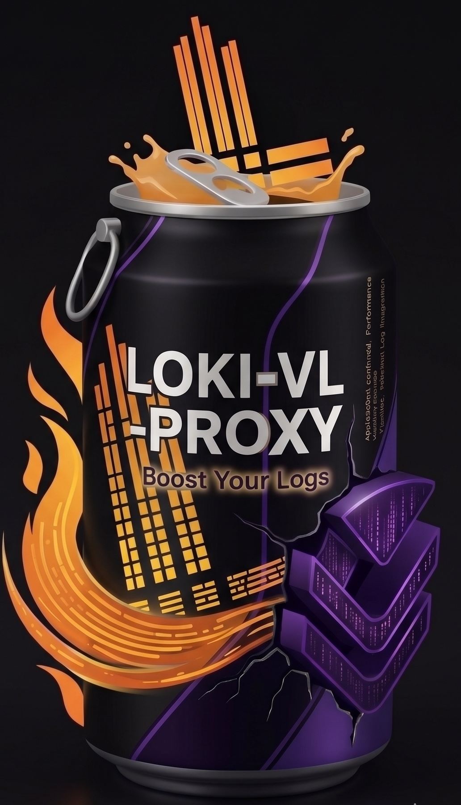
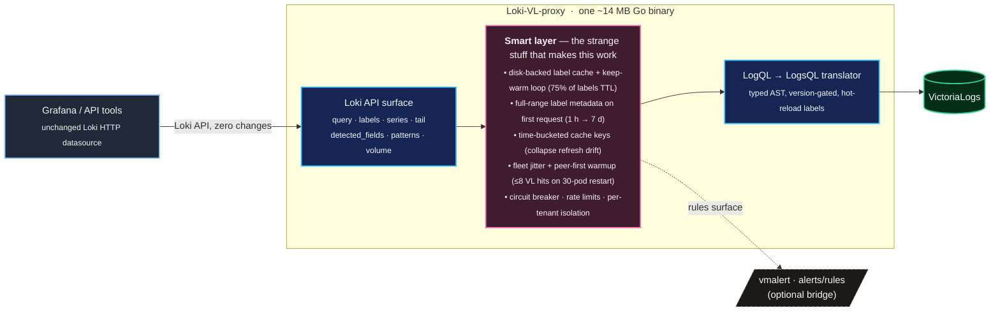
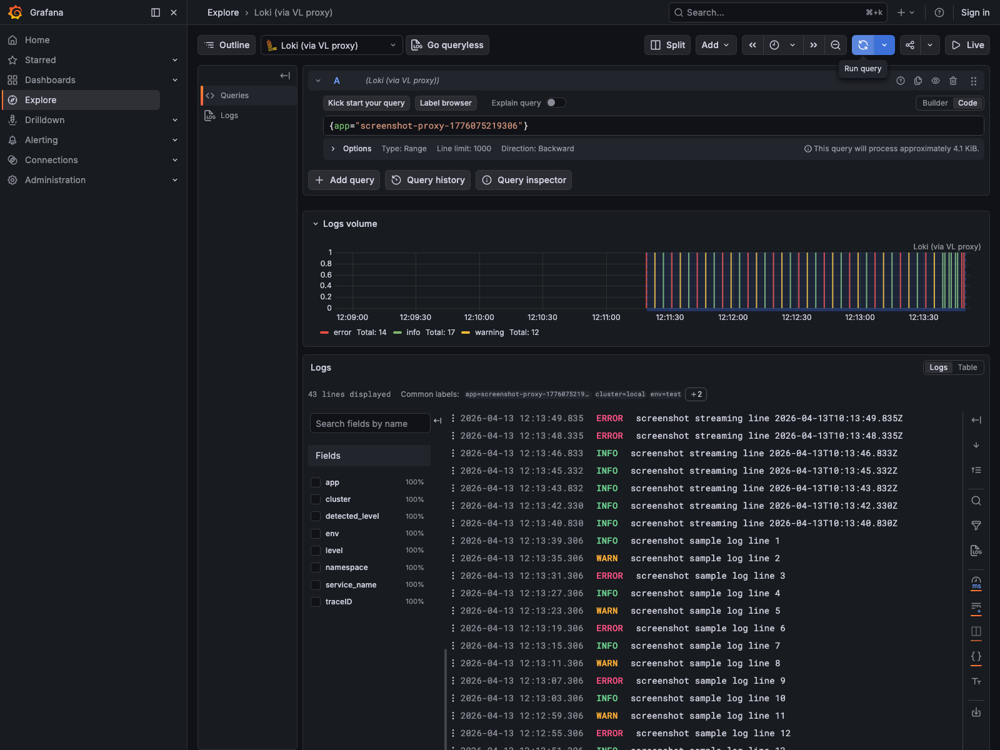
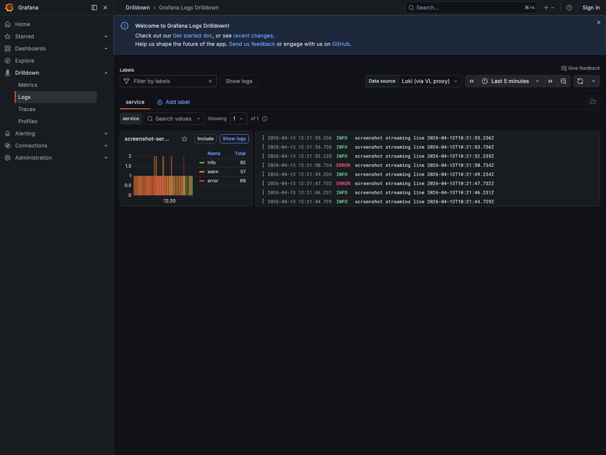
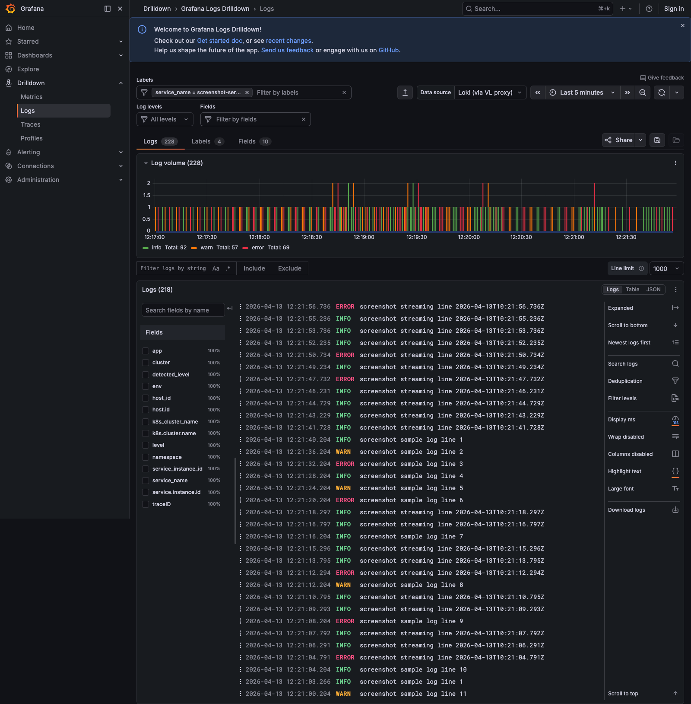
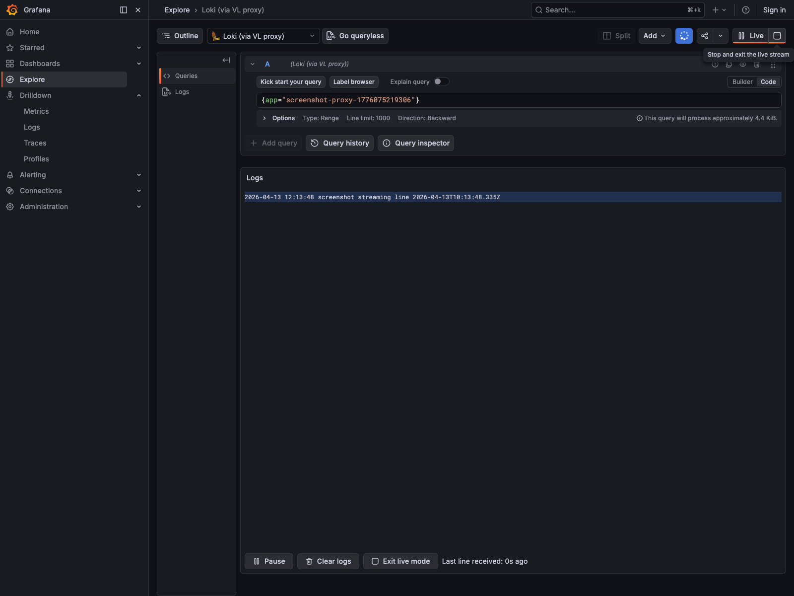

# Loki-VL-proxy

<p align="center">
  <picture>
    <source media="(prefers-color-scheme: dark)" srcset="website/static/img/loki-vl-proxy-logo-white.jpg">
    
  </picture>
</p>

[](https://github.com/ReliablyObserve/Loki-VL-proxy/actions/workflows/ci.yaml)
[](https://goreportcard.com/report/github.com/ReliablyObserve/Loki-VL-proxy)
[](https://github.com/ReliablyObserve/Loki-VL-proxy/actions/workflows/compat-loki.yaml)
[](https://github.com/ReliablyObserve/Loki-VL-proxy/actions/workflows/compat-drilldown.yaml)
[](https://github.com/ReliablyObserve/Loki-VL-proxy/actions/workflows/compat-vl.yaml)
[](https://go.dev/)
[](https://github.com/ReliablyObserve/Loki-VL-proxy/releases)
[](https://hub.docker.com/r/reliablyobserve/loki-vl-proxy)
[](https://github.com/ReliablyObserve/Loki-VL-proxy/pkgs/container/loki-vl-proxy)
[](https://github.com/ReliablyObserve/Loki-VL-proxy/pkgs/container/charts%2Floki-vl-proxy)
[](https://github.com/ReliablyObserve/Loki-VL-proxy)
[](https://github.com/ReliablyObserve/Loki-VL-proxy)
[](#tests)
[](#tests)
[](#logql-compatibility)
[](LICENSE)
[](https://github.com/ReliablyObserve/Loki-VL-proxy/actions/workflows/codeql.yaml)
[](https://scorecard.dev/viewer/?uri=github.com/ReliablyObserve/loki-vl-proxy)

<p align="center">
  <a href="https://buymeacoffee.com/szibis"></a>
  <a href="https://liberapay.com/szibis/donate"></a>
</p>

📖 **Project site:** [reliablyobserve.github.io/Loki-VL-proxy](https://reliablyobserve.github.io/Loki-VL-proxy/) — full docs, benchmarks, runbooks, comparison matrix.

<details>
<summary><strong>How it works (TLDR)</strong></summary>

LogQL queries arrive → parsed into a typed AST (`internal/logql`) → translated into LogsQL via a typed builder (`internal/logsql`) → sent to VictoriaLogs.

Both parsers are hand-written recursive descent. The LogQL side handles the full Loki grammar. The LogsQL side uses a builder API that produces typed, syntactically valid LogsQL at construction time. A query is translated by one of two paths that write the same LogsQL: the typed query plan (the Loki-semantics logical plan lowered to LogsQL AST nodes), which serves a growing set of log and metric shapes, and the older string translator for the rest. `-query-plan-lowering` switches the plan path; [LogQL parser](docs/logql-parser.md#query-plan-lowering-which-translator-answers) lists which shapes each path serves.

**Label metadata and cache reuse:** `/labels` and `/label/{name}/values` cover the requested range, using metadata inventories and cached time buckets rather than only a recent slice. Settled buckets can be reused from memory, disk and peers; recent edges and buckets due for revalidation still read VictoriaLogs. Near-now freshness, empty answers, stale-on-error responses and optional indexed browse limits follow the configured rules in [Metadata caching](docs/configuration.md#metadata-vs-live-query-freshness). A cache hit is not a guarantee of immediate visibility after retention or deletion; distributed deletion-generation metadata is not implemented.

**Moving JSON metric windows:** complete raw JSON `count_over_time` and `rate` answers can reuse settled evaluation points from the Loki-facing RAM/SSD/peer cache, preserving their original age and step phase. Missing edges are evaluated again; native field histograms and truncated answers retain their existing rules. See the [production troubleshooting signals](docs/cache-troubleshooting.md) and [48h three-node comparison](bench/cache-placement/results/2026-11-01-ordered-json-window-reuse/README.md) for the measured benefit and costs.

**Fleet restart behavior:** disk restore, startup jitter and peer warmup can reduce repeated VictoriaLogs reads. Their effect depends on surviving cache state, owner/replica availability and freshness. The [fleet documentation](docs/fleet-cache.md) describes the supported recovery cases; it does not guarantee fleet-wide cold-miss coordination or that only one pod ever reads the backend.

</details>

**Keep your entire Loki stack — Grafana Explore, Drilldown, dashboards, API tooling — and run it on VictoriaLogs.**

- **Drop-in Loki API.** Point your existing Grafana Loki datasource at the proxy. Zero plugin changes and no query rewrites for supported LogQL; measured gaps are listed in [compatibility gaps](docs/real-window-compatibility-gaps.md) and [Known Issues](docs/KNOWN_ISSUES.md).
- **Measured resource difference.** At 310 GiB/day ingest: VL + proxy runs on **1.4 cores and 6.1 GiB RAM**. Loki's published minimum for that ingest class: 38 cores, 59 GiB. That gap is real — not a benchmark artifact. A [local single-machine comparison](#local-resource-comparison) is generated from a committed harness.
- **Proxy intelligence built in.** Disk-backed label cache with keep-warm loop, full-range metadata on the first response, time-bucketed keys, adaptive parallelism, circuit breaker, rate limits, tenant isolation. Fleet restart safety: jitter + peer-first warmup keeps rolling restarts from thundering VL. One ~14 MB static binary.

## Production readiness

The aim is a production workhorse for the whole query path: Grafana Explore, Logs Drilldown, dashboards and Loki API clients, with Loki's tenancy and auth behaviour, Loki's default limits and Loki's error answers, on one proxy or a fleet of them in front of VictoriaLogs. "Production-ready" means one thing here: a team points Grafana at the proxy instead of Loki and notices nothing except that it is faster and cheaper, and runs it as a fleet without risk to VictoriaLogs.

**Where it stands.** The query path is in production use and close to fully production-ready; it is not finished. The tables generated below are the evidence and the authority: [Readiness by client](#quality-and-performance-vs-loki-current) (Explore, Logs Drilldown, the Loki datasource and API clients), the open differences and their impact on Grafana, and the speed distribution against Loki. This text does not repeat their numbers; what they still show open is the remaining work.

**What is in place** (all on `main`, see the [CHANGELOG](CHANGELOG.md)):

- Loki's answers at the boundary: a query Loki rejects from the request alone is refused before any VictoriaLogs call, with Loki's status and text, and so is a tail handshake that fails; one spelling of a query is read whatever blanks, comments or parentheses surround it; `sum`, `max`, `min` and `avg` over the unwrap range functions after `| json` or `| logfmt` read Loki's series on `query_range` with a range longer than the step (two related sliding-window differences are open in the registry).
- Loki's tenancy and auth: tenancy is off by default as in Loki with `auth_enabled: false`, and Loki's answers for a missing, unknown or multiple org ID when it is on ([Tenancy and authentication](docs/tenancy-and-auth.md)); the delete API is behind its own token and runs Loki's delete requests as VictoriaLogs delete tasks.
- Loki's default limits: `max_query_length` (`721h`) and `limit` (100 entries on a range log query that sends none); the query length can also be set per tenant.
- VictoriaLogs stays protected: identical read requests share one run, a failed answer is held for its class (a second or a few, never pushed to peers) so a refreshing dashboard does not ask a failing VictoriaLogs again on every refresh, the circuit breaker and retry budget bound retries, a label named like `_TIME` no longer restarts VictoriaLogs, and a query with certain non-ASCII characters is rejected with Loki's 400 instead of stalling the parser.
- Who is asking: per-tenant, per-user and per-Grafana-app attribution in the request logs, per-tenant VictoriaLogs cost metrics and `/debug/queries` for the heaviest callers ([Operations](docs/operations.md)).

**Remaining steps for the query path** (each is tracked in a generated report, so the list shrinks as the reports do):

1. Close the open differences Grafana shows: the Explore-visible and Logs Drilldown-visible ones first, ranked in the [parity gaps](conformance/reports/parity-gaps.md).
2. Prove the behaviours still unproven or partly proven: the [compatibility roadmap](conformance/reports/roadmap.md) lists them in client order.
3. Bring every shape and range to at least Loki's speed, and no row above 2x Loki: the rows above 2x are listed in the performance summary below and are defects until they leave it.
4. Match Loki's remaining error answers (the known error differences in the quality summary below).
5. Keep proving all of it on the two tested VictoriaLogs versions and on a multi-replica fleet.

**Alerting is not ready.** The proxy does not evaluate alerting or recording rules and does not implement Loki's ruler API; only a read bridge shows vmalert's rules and alerts to Grafana ([Rules and alerts migration](docs/rules-alerts-migration.md)). Loki-style alerting and recording rules are the next big area, started once the query path is 100% ready. Until then run `vmalert` against VictoriaLogs and do not plan on the proxy for rule evaluation.

**In progress** (open pull requests, not shipped; as of 2026-11-18): [#1647](https://github.com/ReliablyObserve/loki-vl-proxy/pull/1647) folding a parser's series identity in one scan, [#1652](https://github.com/ReliablyObserve/loki-vl-proxy/pull/1652) one series per parser identity whatever the key order of its lines, [#1649](https://github.com/ReliablyObserve/loki-vl-proxy/pull/1649) and [#1651](https://github.com/ReliablyObserve/loki-vl-proxy/pull/1651) linear-time handling of deeply nested queries, [#1650](https://github.com/ReliablyObserve/loki-vl-proxy/pull/1650) predicting VictoriaLogs refusals before the call and holding them, [#1653](https://github.com/ReliablyObserve/loki-vl-proxy/pull/1653) testing against Loki 3.7.10, [#1655](https://github.com/ReliablyObserve/loki-vl-proxy/pull/1655) pinning Grafana 13.3.1 and Logs Drilldown 3.2.0, and the VictoriaLogs v1.54 bump (no pull request yet); see [Supported versions](#supported-versions).

## Quality and performance vs Loki (current)

<!-- verified-numbers:start -->

Verified 2026-11-27 on `b9761cf33f1b` (Loki 3.7.10, VictoriaLogs v1.49.0 and v1.54.0), 52 check(s) red; see the [daily summary](https://github.com/ReliablyObserve/loki-vl-proxy/blob/main/conformance/registry/generated/verification/summary.json).

- Registry: 201 open, 178 fixed, 16 documented, 7 owner-kept, 5 upstream; open by impact: 113 explore-visible, 18 drilldown-visible, 2 grafana-datasource, 21 api-only, 47 edge.
- Registry cases sent to Loki and the proxy, per VictoriaLogs version: v1.49.0: 187 match, 92 differ on equal data, 40 not comparable on that day's data, 125 blocked; v1.54.0: 187 match, 92 differ on equal data, 40 not comparable on that day's data, 125 blocked.
- Errors: 242 of 248 recorded Loki answers match, 6 known differences, 0 known leaks; 0 of 0 rows answered as recorded by the live Loki.
- Grammar sweep of 25824 queries, re-verified live by `query-corpus.yaml` on 2026-11-27 (failure): 383 VictoriaLogs rejects the translator text, 32 accepted, translation fails, 24 error text differs, 23 proxy accepts, Loki rejects, 17 tree fact differs: binary operation, 12 error text differs, rejected at translation, 10 proxy rejects, Loki accepts, 4 tree fact differs: offsets, 4 tree fact differs: outermost operation, 3 tree fact differs: has a log pipeline.
- Performance, weekly full run verified 2026-11-23 (Loki 3.7.10): 525 comparable shape x range pairs, 329 faster, 171 on par, 25 slower; 5 rows above 2x Loki.
- Performance, daily smoke verified 2026-11-27: 225 rows, 2 above 2x Loki, 7 weekly ratchet rows lost.
- Cache reuse, verified 2026-11-27: registry cases on v1.49.0: 259 repeats served from the cache, 1 not (2 VictoriaLogs calls on the repeats); registry cases on v1.54.0: 259 repeats served from the cache, 1 not (2 VictoriaLogs calls on the repeats); perf smoke: 15 of 225 rows repeat without calling VictoriaLogs.

<!-- verified-numbers:end -->

<!-- quality-summary:start -->

Tested against Loki v3.7.10, the release the compatibility stack and CI pin. Timings were measured on 2026-11-23 at commit `895c23078f` on the project's A/B stack: the same data, the same hardware, the latest valid weekly run of each of 39 query-shape sets over 1h to 24h. A pair is one query shape over one time range; "comparable" means both sides answered 200 and Loki's results cache did not answer the first request. Faster and slower mean beyond 25% and 50 ms; everything else is on par. A `topk` or `bottomk` answer is compared by its ranked points and their sum, not by its series count.

Loki profile shown: `loki-defaults`, Loki with its own defaults (align_queries_with_step off, max_cache_freshness_per_query 10m); proxy builds run with their defaults. The `aligned` profile (the stack's Loki (align_queries_with_step on, max_cache_freshness_per_query 0s)) is measured too: the distribution table below shows both profiles, the rest of this section the one shown. The proxy serves Loki's read API; write endpoints such as push are not supported (ingest goes to VictoriaLogs directly). Optional deletion management is outside read API scores: its opt-in handler runs Loki's create and cancel as VictoriaLogs delete tasks, and answers Loki's 500 for the list and for queries a VictoriaLogs filter cannot select. The alerting-rules read API remains in scope, including `/api/prom/rules*` for vmalert. The deprecated read aliases `/api/prom/label`, `/api/prom/label/{name}/values`, `/api/prom/query`, `/api/prom/series` and `/api/prom/tail` are unsupported and excluded from totals, gaps and compatibility scores (owner 2026-10-31); use the corresponding `/loki/api/v1` routes. No other write endpoint is planned.

**🟢 Where the proxy is better than Loki**

- First request: **336 of 570** comparable pairs are faster (59%).
- Drilldown and Explore pages: **84 of 118** faster (71%); median first request **0.13 s** against Loki's **0.42 s**.
- Metric queries: **229 of 366** faster (63%); median first request **0.09 s** against **0.26 s**.
- Label and label-value calls: median repeat **0.00 s** against Loki's **0.03 s**, over 36 pairs (36 of them answered by Loki's results cache).
- Share of rows below Loki, first request: **59.2%** (336 of 568 rows); repeat: **12.0%** (92 of 765). The target is most queries below Loki (above 50%).

**🟡 Where it is on par**

- First request: **206 of 570** pairs are within noise (36%).
- Log queries: **57 of 79** on par; metric queries: **121 of 366**; Drilldown and Explore pages: **25 of 118**.
- Rows close to Loki (within the same noise): **206** on the first request, **671** on a repeat.
- Repeat of the same query, median p50: Drilldown and Explore pages **0.01 s** against **0.04 s**; metric queries **0.01 s** against **0.02 s**; log queries **0.01 s** against **0.05 s**.
- Answers: **730 of 785** pairs return the same result as Loki (93%).
- `sum_over_time`, `avg_over_time`, `max_over_time` and `min_over_time` over an unwrapped field answer Loki's window on `query_range` for a range longer or shorter than the step (some outer aggregations of them are still listed as open differences).
- An unwrap metric moved forward by a refresh or a re-run reads from VictoriaLogs only the buckets it has not read before.
- A zero divisor of `/` and `%` is NaN, like Loki.
- Binary vector matching raises Loki's duplicate-series error text at the first step where Loki's join fails.
- Eligible shared cache keys use owner plus one backup by default (`-peer-replication-factor=2`); RF=1 keeps only the owner. Nonowner RAM shadows are bounded to 30s and 10% of L1 capacity without extra disk copies. Three-node tests cover pooled capacity, disk refill and owner loss.

**🔴 Where it is worse**

- First request: **28 of 570** pairs are slower (5%): log queries **0 of 79**, Drilldown and Explore pages **9 of 118**, metric queries **16 of 366**.
- Between 1× and 2× Loki: **22** rows on the first request, **2** on a repeat; above 2× Loki: **4** on the first request and **0** on a repeat (the 2026-11-23 distribution).
- **3 shape, range and mode rows are on the above-2× list for the `loki-defaults` profile** (more than 2× Loki and more than 50 ms slower): **3** on the first request, **0** on a repeat, **0** on a refresh. Each is a defect being fixed: a row joins the list after two consecutive weekly runs above 2× and leaves it after two within 2×, so it can hold more or fewer rows than the day's distribution above; a change that adds or worsens a row is flagged. 30 of 116 covered registry items are locked at their bound (29 at 2×, 1 at 1×).
- In the run shown, **2** of those rows measured above 2× Loki and **1** within 2×.
- Largest gaps on that list in the run shown, first request: `LS8 json count by level_extracted, collision` over 6h, **0.51 s** against **0.18 s**; `LS8 json count by level_extracted, collision` over 1h, **0.10 s** against **0.04 s**.
- Answers: **40 of 785** pairs return a different result from Loki, and **15** could not be compared.

**Distribution versus Loki in the run shown, both Loki profiles**

Rows compared: both sides answered 200 and, on a first request, Loki's results cache did not answer. Bands are those of `bench/ab/over2x.py`: beyond 25% and 50 ms, and above 2× Loki also more than 50 ms behind. The `aligned` profile runs the range-metric shapes only (the queries its setting changes).

| Loki profile | Request | Rows compared | 🟢 Below Loki | 🟡 Close to Loki | 🟠 1–2× Loki | 🔴 Above 2× Loki | Not judged: Loki not 200 / proxy not 200 / first request from Loki's cache |
|---|---|---:|---:|---:|---:|---:|---|
| `loki-defaults` | first | 568 | 336 (59.2%) | 206 (36.3%) | 22 (3.9%) | **4 (0.7%)** | 20 / 0 / 195 |
| `loki-defaults` | repeat | 765 | 92 (12.0%) | 671 (87.7%) | 2 (0.3%) | **0 (0.0%)** | 20 / 0 / — |
| `aligned` | first | 447 | 305 (68.2%) | 123 (27.5%) | 17 (3.8%) | **2 (0.4%)** | 19 / 0 / 82 |
| `aligned` | repeat | 529 | 27 (5.1%) | 499 (94.3%) | 3 (0.6%) | **0 (0.0%)** | 19 / 0 / — |

**By workload in the run shown**

First request and repeat of the comparable pairs of the `loki-defaults` run, as p50 · p90 · slowest pair: the median hides the heavy queries, the p90 and the slowest show them. The counts are of pairs, with the rule above (🟢 faster, 🟡 on par, 🔴 slower). A repeat is the recorded p50 of the repeated request, which may be a cache hit on either side.

| Workload | Pairs | 🟢 / 🟡 / 🔴 | First request: proxy | Loki | Repeat p50: proxy | Loki |
|---|---:|:---:|---:|---:|---:|---:|
| Metadata and label browser | 7 | 1 / 3 / 3 | **0.28 · 1.31 · 1.31 s** | 0.06 · 0.82 · 0.82 s | 🟡 **0.03 s** | 0.06 s |
| Drilldown and Explore pages | 118 | 84 / 25 / 9 | **0.13 · 1.14 · 6.83 s** | 0.39 · 4.95 · 11.49 s | 🟡 **0.01 s** | 0.04 s |
| Log queries | 79 | 22 / 57 / 0 | **0.01 · 0.07 · 0.15 s** | 0.05 · 0.21 · 1.14 s | 🟡 **0.01 s** | 0.05 s |
| Metric queries | 366 | 229 / 121 / 16 | **0.09 · 1.07 · 6.27 s** | 0.26 · 4.17 · 41.66 s | 🟡 **0.01 s** | 0.02 s |

**By time range, first request**

How each side grows with the range a user picks: p50 · p90 · slowest pair of each workload and range.

| Workload | Range | Pairs | 🟢 / 🟡 / 🔴 | Proxy | Loki |
|---|---|---:|:---:|---:|---:|
| Drilldown and Explore pages | 1h | 40 | 25 / 12 / 3 | **0.03 · 0.13 · 0.49 s** | 0.20 · 0.27 · 0.90 s |
| Drilldown and Explore pages | 6h | 36 | 27 / 9 / 0 | **0.14 · 0.72 · 1.16 s** | 0.88 · 1.39 · 2.54 s |
| Drilldown and Explore pages | 24h | 40 | 31 / 3 / 6 | **0.54 · 2.54 · 6.83 s** | 4.62 · 5.37 · 11.49 s |
| Log queries | 1h | 31 | 2 / 29 / 0 | **0.04 · 0.09 · 0.11 s** | 0.04 · 0.08 · 0.21 s |
| Log queries | 3h | 8 | 3 / 5 / 0 | **0.01 · 0.02 · 0.02 s** | 0.05 · 0.10 · 0.10 s |
| Log queries | 6h | 20 | 9 / 11 / 0 | **0.01 · 0.04 · 0.05 s** | 0.06 · 0.18 · 0.41 s |
| Log queries | 24h | 20 | 8 / 12 / 0 | **0.01 · 0.05 · 0.15 s** | 0.06 · 1.01 · 1.14 s |
| Metric queries | 1h | 130 | 70 / 58 / 2 | **0.03 · 0.11 · 0.31 s** | 0.13 · 0.29 · 3.86 s |
| Metric queries | 6h | 101 | 76 / 20 / 5 | **0.17 · 0.60 · 1.68 s** | 0.69 · 1.58 · 14.54 s |
| Metric queries | 24h | 99 | 78 / 12 / 9 | **0.59 · 2.40 · 6.27 s** | 3.28 · 5.76 · 31.12 s |

**The heaviest queries for Loki in the run shown**

The 10 comparable pairs Loki takes longest to answer on a first request: the queries a user waits for. The multiple is Loki's time over the proxy's, or the reverse when the proxy is slower.

| Query shape | Range | Workload | Proxy | Loki | Proxy vs Loki |
|---|---|---|---:|---:|---|
| `F1 sum by over a ratio of two per-stream metrics, 20s step` | 24h-20s | Metric queries | **4.29 s** | 41.66 s | 🟢 9.7× faster |
| `B2 sum by over a ratio of two per-stream metrics` | 24h | Metric queries | **3.96 s** | 31.12 s | 🟢 7.9× faster |
| `F3 avg by service of rate, 20s step` | 24h-20s | Metric queries | **2.04 s** | 15.57 s | 🟢 7.6× faster |
| `B2 sum by over a ratio of two per-stream metrics` | 6h | Metric queries | **1.04 s** | 14.54 s | 🟢 14.0× faster |
| `F2 count by service of count_over_time, 20s step` | 24h-20s | Metric queries | **0.01 s** ‡ | 12.58 s | 🟢 1397.6× faster |
| `F4 sum of max by service,app, 20s step` | 24h-20s | Metric queries | **4.29 s** | 12.04 s | 🟢 2.8× faster |
| `DB1 label breakdown pod` | 24h | Drilldown and Explore pages | **1.32 s** | 11.49 s | 🟢 8.7× faster |
| `logfmt volume` | 24h | Metric queries | **1.44 s** | 7.86 s | 🟢 5.5× faster |
| `logfmt count by level, filter, drop` | 24h | Metric queries | **2.72 s** | 7.78 s | 🟢 2.9× faster |
| `SF9 volume, logfmt label_format rename` | 24h | Metric queries | **3.52 s** | 7.15 s | 🟢 2.0× faster |

‡ The proxy answered a first request over 6h or more in under 50 ms: probably from its own cache, warmed by an earlier set of the weekly run that sent the same query. The run records Loki's cache counters but not the proxy's, so this row is not a cold proxy.

**Where the proxy loses most in the run shown**

| Query shape | Range | Workload | Proxy | Loki | Proxy vs Loki |
|---|---|---|---:|---:|---|
| `DP1 patterns of a plain-text service` | 1h | Metadata and label browser | **0.30 s** | 0.02 s | 🔴 13.5× slower |
| `DP2 patterns of an environment` | 1h | Metadata and label browser | **1.31 s** | 0.28 s | 🔴 4.7× slower |
| `LF10 drilldown logs, level pill multi-select, json service` | 1h | Drilldown and Explore pages | **0.13 s** | 0.03 s | 🔴 3.8× slower |
| `LS8 json count by level_extracted, collision` | 6h | Metric queries | **0.51 s** | 0.18 s | 🔴 2.8× slower |
| `LS8 json count by level_extracted, collision` | 1h | Metric queries | **0.10 s** | 0.04 s | 🔴 2.5× slower |

Label browser and Drilldown metadata calls: every pair both sides answered with 200, including the first requests Loki's results cache answered (counted in the third column; a Loki time near zero there is its cache). Medians.

| Call | Pairs | Loki cache-answered | First request: proxy | Loki | Repeat: proxy | Loki |
|---|---:|---:|---:|---:|---:|---:|
| Drilldown detected labels and fields | 15 | 15 | 🟡 **0.02 s** | 0.03 s | 🟡 **0.00 s** | 0.01 s |
| Label values | 18 | 18 | 🟡 **0.01 s** | 0.04 s | 🟡 **0.00 s** | 0.04 s |
| Labels (label browser) | 18 | 18 | 🟡 **0.01 s** | 0.01 s | 🟡 **0.00 s** | 0.01 s |
| Volume (Drilldown landing) | 9 | 2 | 🔴 **0.28 s** | 0.13 s | 🟡 **0.02 s** | 0.06 s |

**Quality of the Loki read API**

| | Now |
|---|---|
| Loki endpoints the proxy routes | **25 of 27** (93%) |
| Endpoints with tests that compare the proxy against Loki | **19 of 27** (70%) |
| Endpoints whose registry state is `proven` | **12 of 27** (44%) |
| Routed endpoints answered natively by VictoriaLogs | 14 of 25 |
| Behaviour and feature items | 11 proven, 27 partial, 3 gaps |
| Known differences from Loki (ranked) | **229**: 201 open, 16 documented, 7 owner-kept, 5 upstream |
| Open differences visible in Grafana (registry impact) | **133 of 201**: 113 Explore, 18 Logs Drilldown, 2 Grafana datasource; 21 API only, 47 edge cases |

**Readiness by client**

The Loki endpoints each client calls (registry `consumers`), with the same evidence as above, and the open differences filed as visible to that client.

| Client | Loki endpoints it calls | Routed | Compared with Loki in tests | Proven | Open differences it shows |
|---|---:|---:|---:|---:|---:|
| Grafana Explore | 10 | 10 (100%) | 10 (100%) | 8 (80%) | 113 |
| Logs Drilldown | 11 | 11 (100%) | 11 (100%) | 9 (82%) | 18 |
| Grafana Loki datasource | 6 | 6 (100%) | 6 (100%) | 4 (67%) | 2 |
| Loki API clients | 27 | 25 (93%) | 19 (70%) | 12 (44%) | 21 |

Read routes not implemented: `/loki/api/v1/cache/generation_numbers`, `/loki/api/v1/index/shards` (optional planner gap, low priority).

These are registry evidence counts, not a full runtime compatibility percentage. Optional deletion management is excluded from the read totals; deprecated aliases and write-only APIs are outside this score.

The 5 open differences with the most impact (all explore-visible): `quality/series-identity-projection-unverified` (metric identity-policy projection lacks full source, point, window and limit proof), `semantics/unwrap-parserless-reads-stored-field` (an unwrap with no parser reads the field VictoriaLogs stored for the line where Loki has no label), `semantics/log-line-format-function-catalog-rejections` (log line_format rejects template functions accepted by Loki), `semantics/composed-parser-count-rate-bytes-vector-fold-values` (vector folds after parser and format compositions return different values), `parsed-identity/bare-parser-metric-duplicates-extracted` (bare JSON metrics cannot distinguish equal-valued metadata from ingested body fields). Differences kept on purpose are listed as documented or owner-kept.

Details, the per-workload tables and the method: [performance summary](conformance/reports/performance.md#summary-versus-loki) · [performance guide](docs/performance.md#current-position-versus-loki) · [ranked differences](conformance/reports/parity-gaps.md) · [coverage map](conformance/reports/coverage-map.md) · [Known Issues](docs/KNOWN_ISSUES.md).

<!-- quality-summary:end -->

**Two-day (48h) ranges**, measured separately on 2026-11-04 (commit `69d07019b3`, Loki v3.7.9, VictoriaLogs v1.53.0, both Loki profiles): on a first request the proxy is faster than Loki on **81–83%** of compared rows and above 2x Loki on at most 2 rows (1.4%), both waiting for a confirming run; a long-range load test kept `/labels` at 249 of 249 answers 200 with no VictoriaLogs or Loki restart. One open defect shows only at this range: answers larger than the buffered-response limit (B2, and the same shapes at a 20 s step) answer 500 where Loki answers 200. Details: [two-day ranges](docs/performance.md#two-day-ranges-48h).

---

## One-glance comparison

The current position is generated from the latest weekly A/B run in [Quality and performance vs Loki](#quality-and-performance-vs-loki-current) above: the distribution of every shape and range against Loki in both Loki profiles (🟢 below Loki, 🟡 close, 🟠 1–2×, 🔴 above 2×), the medians by workload, and the label browser and Drilldown metadata calls. The rules: a pair is one query shape over one time range, faster or slower means beyond 25% and 50 ms, and a first request Loki's results cache answered is not judged.

Method, every shape and range, the open gaps and the regression gate: [performance evidence](conformance/reports/performance.md#summary-versus-loki) · [performance guide](docs/performance.md#current-position-versus-loki) · [ranked differences](conformance/reports/parity-gaps.md). The earlier 2026-06-05, 36-query Drilldown comparison (including CPU and memory measurements) remains in [the historical benchmark](docs/honest-tldr.md), with its [reproduction script](bench/drilldown-vs-loki.sh) and [raw results](test/e2e-compat/results/).

---

## Query Performance

Latency against Loki by workload and for the label browser and Drilldown metadata calls is generated from the latest weekly A/B run in [Quality and performance vs Loki](#quality-and-performance-vs-loki-current); every shape and range is in the [performance evidence](conformance/reports/performance.md#summary-versus-loki).

### Translation overhead

<!-- translation-overhead:start -->

Measured on 2026-11-23 at commit `895c23078f` by the weekly run: LogQL to LogsQL translation took **6.1 to 31.3 µs per query**. For a 100 to 500 ms VictoriaLogs round-trip this is under 0.03% of wall time.

| Query type | Time | Allocs |
|---|---:|---:|
| Selector `{app="nginx"}` | 6.1 µs | 16 |
| `rate({app="nginx",env="production"}[5m])` | 14.6 µs | 60 |
| `sum(rate({...}[5m])) by (host)` | 13.9 µs | 52 |
| `\| ip("10.0.0.0/8")` filter | 10.0 µs | 28 |
| Binary metric `sum(rate) / sum(rate)` | 31.3 µs | 95 |

Median of 5 runs of `go test ./internal/translator/ -bench BenchmarkTranslate -benchmem` with `GOMAXPROCS=4`, go1.27.4 on AMD EPYC 7763 64-Core Processor (amd64), the weekly run's machine, which runs other work too: the times are an upper bound.

<!-- translation-overhead:end -->

### Throughput under load (historical)

> **Historical: measured on proxy v1.50.0 with Loki 3.6.x and VictoriaLogs v1.50.0 using `loki-bench`; not re-measured.** It compares a warm, cache-assisted proxy with Loki on a synthetic mix and is not the current position. The method and the other throughput tables are in [Benchmarks](docs/benchmarks.md).

Measured with `loki-bench --jitter=2h --warmup=5s --duration=30s` on an Apple M5 Pro (18 cores, 64 GB RAM), ~8 M log entries across 15 services, 7-day window.

| Workload | Concurrency | Loki | Proxy | VL native | Proxy / Loki |
|---|:---:|---:|---:|---:|:---:|
| Small (metadata) | c=10 | 919 req/s | 2,785 req/s | 3,756 req/s | **3.0×** |
| Small (metadata) | c=50 | 726 req/s | 2,099 req/s | 3,793 req/s | **2.9×** |
| Small (metadata) | c=100 | 578 req/s | 1,822 req/s | 3,538 req/s | **3.2×** |
| Heavy (pipelines) | c=10 | 146 req/s | 483 req/s | 2,532 req/s | **3.3×** |
| Heavy (pipelines) | c=50 | 247 req/s | 582 req/s | 2,000 req/s | **2.4×** |
| Heavy (pipelines) | c=100 | 279 req/s | 568 req/s | 1,952 req/s | **2.0×** |
| Compute (rate, topk) | c=10 | 625 req/s | 629 req/s | 3,947 req/s | **parity** |
| Compute (rate, topk) | c=50 | 343 req/s† | 539 req/s | 4,338 req/s | **1.6×** |
| Compute (rate, topk) | c=100 | 410 req/s† | 468 req/s | 4,473 req/s | **1.1×** |

- **Small metadata:** 2.9–3.2× faster — VL label/series scans outperform Loki's chunk store, amplified by proxy cache.
- **Heavy pipelines:** 2.0–3.3× faster — `stats_query_range` fast path + response caching.
- **Compute:** parity at c=10; proxy dominates under pressure because Loki saturates.

† Loki compute c=50: **90.55% error rate** (saturated). c=100: **97.49% error rate**. Proxy: 0% errors at all concurrency levels.

### Dashboard load spikes — request coalescer

When many panels hit the same query simultaneously, the proxy collapses them into a single backend call. First-hit coalescing avoids the N-fan-out but pays one backend round-trip; subsequent hits are served from cache.

Full throughput tables, P90/P99 latency, CPU and RSS breakdowns: [Benchmarks](docs/benchmarks.md) · [Performance](docs/performance.md)

---

## The Cost Case

This is a production deployment, not a synthetic benchmark. The numbers below come from a real VictoriaLogs installation running at **310 GiB/day** raw ingest with **800 M total log entries** and **7.1 days** of retention.

**What VictoriaLogs actually consumed at that load:**

| Component | Cores | Memory |
|---|---:|---:|
| `vlstorage` | 1.0 | 5.0 GiB |
| `vlinsert` | 0.1 | 0.6 GiB |
| `vlselect` | 0.1 | 0.25 GiB |
| `loki-vl-proxy` | ~0.1–0.2 | ~0.15–0.26 GiB |
| **VL + loki-vl-proxy, combined** | **~1.4** | **~6.1 GiB** |

For comparison, [Loki's own documentation](https://grafana.com/docs/loki/latest/setup/size/) puts the **minimum** hardware requirement at **38 cores and 59 GiB** for the same ingest class (`<3 TB/day`). That's the floor — a minimal, single-tenant, non-HA deployment.

**Caveat:** `vlselect` was measured at zero read concurrency — query load will add to that number. If you run heavy aggregation queries at scale, benchmark your own workload with `loki-bench` before sizing.

**Storage:** 2,201 GiB of raw logs (310 GiB/day × 7.1 days) compressed to **40.5 GiB on disk — 54.9× compression**. TrueFoundry ran an independent migration and reported ~40% less storage versus their Loki deployment at the same retention.

**Replication:** Loki's recommended production setup uses RF=3 — tripling write load, disk, and cross-AZ egress. VictoriaLogs is designed for AZ-local deployment with no mandatory replication. If you're paying for cross-AZ data transfer today, that alone can outweigh compute savings.

**Migration cost:** Zero changes to Grafana, dashboards, alerts, or any Loki API client. The proxy handles translation transparently; remove it and point back at Loki if needed.

Full cost worksheet, scaling projections, and EC2/GCP sizing tables: [Cost Model](docs/cost-model.md) · [Scaling](docs/scaling.md)

---

## Local resource comparison

<!-- resource-comparison:start -->

Measured on 2026-11-18 at commit `87a871476`, on one machine (Apple M5 Pro (18 cores), 64 GiB, Colima VM, 8 vCPU, 14 GiB, docker (aarch64)): the same read workload sent to a local Loki and then to the proxy with VictoriaLogs, the stack's own ingest running on both. **A local single-machine test, not a production figure**: at production scale the gap can be much larger, see [The Cost Case](#the-cost-case).

| Side | Requests | First run (cold): CPU-seconds | Peak memory, MiB (before) | Repeat (warm): CPU-seconds | Peak memory, MiB (before) | Wall time, first / repeat |
|---|---:|---:|---:|---:|---:|---:|
| Loki | 81 | 265.3 | 7363 (2993) | 130.5 | 7478 (7359) | 86 s / 39 s |
| Proxy + VictoriaLogs | 81 | 67.1 | 674 (307) | 23.9 | 580 (447) | 22 s / 6 s |

For the same requests on the first, cold run Loki used **4.0x** the CPU-seconds and peaked at **10.9x** the memory of the proxy plus VictoriaLogs; on the repeat of the identical requests (caches warm on both sides) **5.5x** the CPU-seconds and **12.9x** the memory.

Method: 81 cold query_range requests: 9 shapes (grouped/ungrouped count, rate, bytes, topk, | json metric, | json unwrap avg, two log queries) x 15m/30m/1h x 3 rounds, distinct steps, 8 concurrent workers; each side measured alone, then each side repeated (identical requests: caches warm). CPU-seconds are the containers' user plus system time during the workload minus each container's idle rate measured just before it (30 s), since ingest keeps running; peak memory is the resident set sampled every 0.5 s, summed over the side's containers, with the memory before the workload in brackets (Loki's was already large after earlier work on the same stack). Wall time is secondary and noisy on a shared host. A busybox sidecar in each container's PID namespace reads `/proc/1`, so scratch images work. Host shared with other work, load average 31-43 during the run; CPU-seconds net of each container's idle ingest rate; peak memory = process RSS sampled every 0.5 s. UI log generator ingesting into both Loki and VictoriaLogs throughout. Images: loki: grafana/loki:3.7.9, proxy: loki-vl-proxy built from 87a871476 (main 8e80a32b7 + the Grafana 13.3.1 / Drilldown 3.2.0 pin commit; no proxy code change), victorialogs: victoriametrics/victoria-logs:v1.53.0. Re-measure with `python3 bench/resources/compare.py`; the results are in `bench/resources/results/latest.json`.

<!-- resource-comparison:end -->

---

## Supported versions

<!-- vl-support:start -->
| VictoriaLogs | Version |
|---|---|
| Supported | `v1.49.0` (the latest v1.4x release) and every v1.5x release |
| Tested in CI | `v1.49.0` (the latest v1.4x release) and `v1.54.0` (the newest v1.5x release) |
| Pull-request CI pin | `v1.54.0` |
| Startup floor (`-backend-min-version`) | `v1.49.0` |
<!-- vl-support:end -->

The proxy refuses to start against a VictoriaLogs older than the floor unless `-backend-allow-unsupported-version=true` is set; such a version is unsupported and untested. CI tests two versions, the latest v1.4x release and the newest v1.5x release; a new v1.5x release replaces the newest. The weekly matrix run includes the range-metric table compared with Loki. What `main` is tested against today: VictoriaLogs `v1.49.0` and `v1.53.0` in the CI comparisons, Loki `3.7.9` (the pinned reference), Grafana `13.3.0` and Logs Drilldown `3.1.0` (the pinned runtime). Bumps to VictoriaLogs `v1.54`, Loki `3.7.10` ([#1653](https://github.com/ReliablyObserve/loki-vl-proxy/pull/1653)), Grafana `13.3.1` and Logs Drilldown `3.2.0` ([#1655](https://github.com/ReliablyObserve/loki-vl-proxy/pull/1655)) are in progress (see [In progress](#production-readiness) above) and not yet tested on `main`. Loki, Grafana, Logs Drilldown and the Loki datasource plugin version families are listed in the [compatibility matrix](docs/compatibility-matrix.md); the VictoriaLogs policy and capability bands are in [VictoriaLogs compatibility](docs/compatibility-victorialogs.md).

---

## Quick Start

### Docker

```bash
docker run -p 3100:3100 \
  ghcr.io/reliablyobserve/loki-vl-proxy:<release> \
  -backend=http://victorialogs:9428
```

Release images are signed; see [Verifying releases](SECURITY.md#verifying-releases) to check the signature and provenance before running one. Replace `<release>` with a version from the [releases page](https://github.com/ReliablyObserve/Loki-VL-proxy/releases) and pin it, rather than using `latest`.

### Helm

```bash
helm install loki-vl-proxy oci://ghcr.io/reliablyobserve/charts/loki-vl-proxy \
  --version <release> \
  --set extraArgs.backend=http://victorialogs:9428 \
  --set extraArgs.patterns-enabled=true
```

### Grafana Datasource

Point your existing Loki datasource at the proxy — no other changes needed.

```yaml
datasources:
  - name: Loki (via VL proxy)
    type: loki
    access: proxy
    url: http://loki-vl-proxy:3100
    jsonData:
      httpHeaderName1: X-Scope-OrgID
    secureJsonData:
      httpHeaderValue1: team-alpha
```

That's it. Grafana Explore, Drilldown, and all dashboards work immediately.

For StatefulSet persistence, peer-cache fleet setup, OTLP push wiring, and image source options, see [Getting Started](docs/getting-started.md) and [Operations](docs/operations.md).

**Peer fleet discovery** — four modes, all refresh every 15 s and rebuild the hash ring live:

| Mode | Flag | Best for |
|------|------|----------|
| `dns` | `-peer-dns=proxy-headless.ns.svc.cluster.local` | Kubernetes headless service — only ready pods appear |
| `srv` | `-peer-srv=_loki-vl-proxy._tcp.proxy-headless.ns.svc.cluster.local` | Kubernetes StatefulSet, Consul DNS — port embedded in record |
| `http` | `-peer-http-url=http://consul:8500/v1/catalog/service/loki-vl-proxy` | Outside k8s: Consul, Nomad, Prometheus HTTP SD, or custom endpoint |
| `static` | `-peer-static=10.0.0.1:3100,10.0.0.2:3100` | Fixed fleets, development |

Verify the live ring at any time: `curl -H 'X-Peer-Token: <peer-auth-token>' http://proxy:3100/_cache/peers` → `{"peers":[...],"self":"...","count":N}` (peer endpoints require the shared token unless `-peer-insecure-ip-allowlist=true`).

Non-Kubernetes examples (static, Consul, Prometheus SD, CoreDNS) are in [`examples/peers/`](examples/peers/).

---

## Why It's Fast

**4-tier cache:**
- **Tier0** — compatibility-edge cache for safe GET responses (no backend hit at all)
- **L1** — in-memory hot path
- **L2** — disk (bbolt), survives restarts, warms historical windows across large working sets
- **L3** — peer cache, lets warm fleet replicas share results instead of all hitting the backend. Four peer discovery modes: `dns` (k8s headless A-records), `srv` (DNS SRV with embedded port, works with Consul DNS and k8s StatefulSets), `http` (polls any JSON endpoint — Consul catalog, Prometheus HTTP SD, custom registry), `static` (fixed list). Discovery refreshes every 15 s; the hash ring updates atomically so peer add/remove is live without restarts.

**Window reuse.** Long `query_range` requests are split into 1h windows. Historical windows are served from cache; only the live edge fetches from VictoriaLogs. A 7-day query with warm cache may hit the backend for a single window.

**Adaptive parallelism.** Parallel window fetches use EWMA-based backpressure — ramps up when VictoriaLogs is fast, backs off automatically before it becomes a problem.

**Identical-request sharing.** Identical read requests (same route, parameters, tenant, credentials and response profile) that arrive while the first one runs wait for it on every cached read route, GET and POST, instead of each asking VictoriaLogs; a failure is handed over with Loki's status and text. Failed answers are then held per replica for the time of their class (`-error-cache-transient-ttl`, `-error-cache-data-ttl`), so a refreshing dashboard does not ask a failing VictoriaLogs on every refresh. See [Operations](docs/operations.md) and the [configuration reference](docs/configuration.md).

**Lock-free hot paths.** Circuit breaker, metrics histograms, and rate limiter use atomic operations instead of mutexes. Structured logging uses an async buffered handler. At 100+ concurrent requests, these eliminate the contention that dominates proxy-added latency.

---

## What Works Out of the Box

- Grafana Explore — log browsing, filtering, live tail
- Grafana Logs Drilldown — patterns, service view, field breakdown
- Dashboards — supported Loki log and metric queries
- Multi-tenant — `X-Scope-OrgID` isolation once enabled (off by default, as Loki with `auth_enabled: false`), including Loki-style `a|b` multi-tenant reads
- Live tail — native WebSocket tail or synthetic polling fallback
- Rules and alerts — read bridge to vmalert (no write lifecycle); Loki-style alerting is **not ready**, see [Production readiness](#production-readiness)
- LogQL — stream selectors, filters, parsers, metric queries, range functions and vector operators, with measured compatibility and documented limitations
- OTel labels — dotted structured metadata exposed correctly in detected fields, underscore-safe in stream labels

---

## Production Features

- **Circuit breaker** — opens on backend failure, closes automatically on recovery; lock-free fast path in healthy state
- **Per-client rate limits** — token bucket per client source IP plus a global in-flight cap (`-max-concurrent`, excess gets `503`)
- **Adaptive log sampling** — below 10 req/s logs everything; above it, OK traffic becomes periodic summaries while errors are always logged
- **Tenant isolation** — off by default (one shared tenant, as Loki with `auth_enabled: false`); once enabled, strict `X-Scope-OrgID` routing and fanout guardrails with no cross-tenant data bleed. The header is not authenticated: put a gateway in front ([Tenancy and authentication](docs/tenancy-and-auth.md))
- **TLS / mTLS** — configurable on both northbound (client) and southbound (backend) boundaries
- **OTLP metrics push** — proxy pushes its own metrics to any OTLP HTTP endpoint
- **Operator dashboard** — packaged Grafana dashboard covering Client → Proxy → VictoriaLogs, cache behavior, fanout, and resource utilization
- **Runbook-backed alerts** — 15 alert rules, each with a linked runbook
- **100+ Prometheus metrics** — all under `loki_vl_proxy_*` prefix
- **Read-only by default** — `/push` returns `405`; `/loki/api/v1/delete` answers `404` like Loki unless `-delete-api-enabled` is set, which needs its own token and runs Loki's create and cancel as VictoriaLogs delete tasks (what is not served is listed in [details](docs/security-hardening-migration.md#remaining-delete-api-gap)); debug/admin disabled unless explicitly enabled
- **Cold storage routing** — time-boundary split to Victoria Lakehouse for long-range queries
- **Loki's default limits** — `query_range` time-range limit as Loki's `max_query_length` (`-default-max-query-length`, default `721h`, per-tenant override via `max_query_length` in `-tenant-limits` / `-tenant-default-limits`); a range log query that sends no `limit` returns Loki's default of 100 entries
- **Who ran what** — request logs carry the tenant, the end user (with `-log-user-header`) and the Grafana app; `loki_vl_proxy_tenant_vl_calls_total` and related metrics count the VictoriaLogs work per tenant; `/debug/queries` (with `-server.enable-query-analytics`, on the admin listener) lists the heaviest callers

---

## How It Works



**What this picture says:** Grafana keeps talking Loki. The proxy translates LogQL to LogsQL on the way down, and the **Smart layer** is where the work happens — every entry in that pink box is what lets a 14 MB binary serve cold Drilldown queries that the official Loki layout can't run at all on 12 GiB RAM. The full per-box exploded view (10 subsystems, every handler, every cache tier, every backend) lives in [`docs/architecture.md`](docs/architecture.md) for operators and contributors.

---

## Compatibility

Loki-VL-proxy is validated continuously in CI against four compatibility contracts: Loki API, Grafana Logs Drilldown, Grafana Loki datasource, and VictoriaLogs integration.

### Label and Field Compatibility

| Profile | Stream labels (`/labels`) | Detected fields / metadata | Best for |
|---|---|---|---|
| Loki-compatible (default) | underscore-only | translated underscore aliases | strict Loki UX, Grafana Explore/Drilldown |
| Mixed | underscore-only | dotted + translated aliases | Grafana + OTel correlation |
| Native-field | underscore-only (`label-style=underscores`) | dotted-native only | VL/OTel-native field workflows |

Default flags: `-label-style=underscores`, `-metadata-field-mode=translated`. Grafana query builder works best with underscore aliases; code mode accepts dotted expressions and translates them to VL-native field matching.

**Tuple safety:** Default responses return strict `[timestamp, line]` 2-tuples. 3-tuple metadata mode activates only when the client sends `X-Loki-Response-Encoding-Flags: categorize-labels`. Cache keys are segregated by tuple mode.

### LogQL Compatibility

CI compares supported LogQL operations with a real Loki oracle. Strict populated-fixture regressions check labels, values, timestamps and errors in addition to the broader syntax/status suite. Correcting the exhaustive helper's timestamp units exposed gaps that its earlier scores missed; passing status or nonempty results does not establish complete LogQL parity. See the [measured findings and remaining limits](docs/real-window-compatibility-gaps.md).

**Typed LogQL parser:** The recursive-descent parser (`internal/logql`) produces a structured AST for validation, routing, and drop/keep extraction. It validates supported semantic constraints, including missing unwrap stages, invalid IP filter arguments and unclosed template delimiters. Grafana receives Loki-style error responses; the compatibility register records remaining syntax and runtime differences.

For full detail: [Loki Compatibility](docs/compatibility-loki.md), [Translation Reference](docs/translation-reference.md), [LogQL Parser](docs/logql-parser.md), [Known Issues](docs/KNOWN_ISSUES.md)

---

## Observability

- **100+ Prometheus metrics** under `loki_vl_proxy_*` — cache hit ratios, window fetch latency, fanout behavior, per-tenant and per-client pressure, circuit breaker state
- **Packaged operator dashboard** — rows for Client-Side Loki API Visibility, Proxy Internal, and Backend-Side VictoriaLogs fanout; fast incident attribution
- **15 runbook-backed alert rules** — backend latency, backend unreachable, circuit breaker open, high error rate, rate limiting, tenant error rate, tuple contract, system resources, and more
- **Structured JSON logs** — route-aware, semconv-aligned, with user-pattern attribution from trusted Grafana headers
- **OTLP metrics push** — the same proxy metrics pushed to any OTLP HTTP endpoint (`-otlp-endpoint`)

See [Observability](docs/observability.md) and [Alert Runbooks Index](docs/runbooks/alerts.md).

---

## Security

- Read-only API surface by default: `/push` blocked, debug/admin disabled; `/loki/api/v1/delete` answers `404` like Loki unless `-delete-api-enabled` is set, which needs its own token and runs Loki's delete requests as VictoriaLogs delete tasks ([what is not served](docs/security-hardening-migration.md#remaining-delete-api-gap))
- Non-root runtime image, read-only root filesystem, restricted Helm security contexts
- Hardening headers on all HTTP responses including 404s and disabled routes
- CI security gates: `gitleaks`, `gosec`, Trivy, `actionlint`, `hadolint`, OpenSSF Scorecard, OWASP ZAP, curated Nuclei
- Proxy-specific coverage: tenant isolation, cache boundary enforcement, browser-origin checks on `/tail`, forwarded auth handling

See [Security](docs/security.md) and [Security Policy](SECURITY.md).

---

## UI Gallery

VictoriaLogs backend with Loki-VL-proxy as the Loki-compatible query layer.

<a href="docs/images/ui/explore-main.png">
  
</a>
<a href="docs/images/ui/explore-details.png">
  
</a>
<a href="docs/images/ui/drilldown-main.png">
  
</a>
<a href="docs/images/ui/drilldown-service.png">
  
</a>
<a href="docs/images/ui/explore-tail-multitenant.png">
  
</a>

---

## Documentation Map

### Core
- [Getting Started](docs/getting-started.md)
- [Configuration](docs/configuration.md)
- [Operations](docs/operations.md)
- [Architecture](docs/architecture.md)
- [API Reference](docs/api-reference.md)
- [Security](docs/security.md)
- [Tenancy and Authentication](docs/tenancy-and-auth.md)
- [Observability](docs/observability.md)
- [Performance](docs/performance.md)
- [Scaling](docs/scaling.md)

### Compatibility
- [Compatibility Matrix](docs/compatibility-matrix.md)
- [Loki Compatibility](docs/compatibility-loki.md)
- [Logs Drilldown Compatibility](docs/compatibility-drilldown.md)
- [Grafana Loki Datasource Compatibility](docs/compatibility-grafana-datasource.md)
- [VictoriaLogs Compatibility](docs/compatibility-victorialogs.md)
- [Translation Modes Guide](docs/translation-modes.md)
- [Translation Reference](docs/translation-reference.md)

### Cache and Runtime Design
- [Fleet Cache](docs/fleet-cache.md)
- [Peer Cache Design](docs/peer-cache-design.md)
- [Benchmarks](docs/benchmarks.md)

### Runbooks
- [Alert Runbooks Index](docs/runbooks/alerts.md)
- [Deployment Best Practices](docs/runbooks/deployment-best-practices.md)
- [Backend High Latency](docs/runbooks/loki-vl-proxy-backend-high-latency.md)
- [Backend Unreachable](docs/runbooks/loki-vl-proxy-backend-unreachable.md)
- [Circuit Breaker Open](docs/runbooks/loki-vl-proxy-circuit-breaker-open.md)
- [Client Bad Request Burst](docs/runbooks/loki-vl-proxy-client-bad-request-burst.md)
- [Proxy Down](docs/runbooks/loki-vl-proxy-down.md)
- [Grafana Tuple Contract](docs/runbooks/loki-vl-proxy-grafana-tuple-contract.md)
- [High Error Rate](docs/runbooks/loki-vl-proxy-high-error-rate.md)
- [High Latency](docs/runbooks/loki-vl-proxy-high-latency.md)
- [Rate Limiting](docs/runbooks/loki-vl-proxy-rate-limiting.md)
- [Operational Resources](docs/runbooks/loki-vl-proxy-system-resources.md)
- [Tenant High Error Rate](docs/runbooks/loki-vl-proxy-tenant-high-error-rate.md)

### Testing and Release
- [Testing](docs/testing.md)
- [CI workflows](docs/ci-workflows.md)
- [Release Info](docs/release-info.md)

### Migration and Project Status
- [Rules And Alerts Migration](docs/rules-alerts-migration.md)
- [Known Issues](docs/KNOWN_ISSUES.md)
- [Roadmap](docs/roadmap.md)
- [Changelog](CHANGELOG.md)

---

## License

Apache License 2.0. See [LICENSE](LICENSE).
