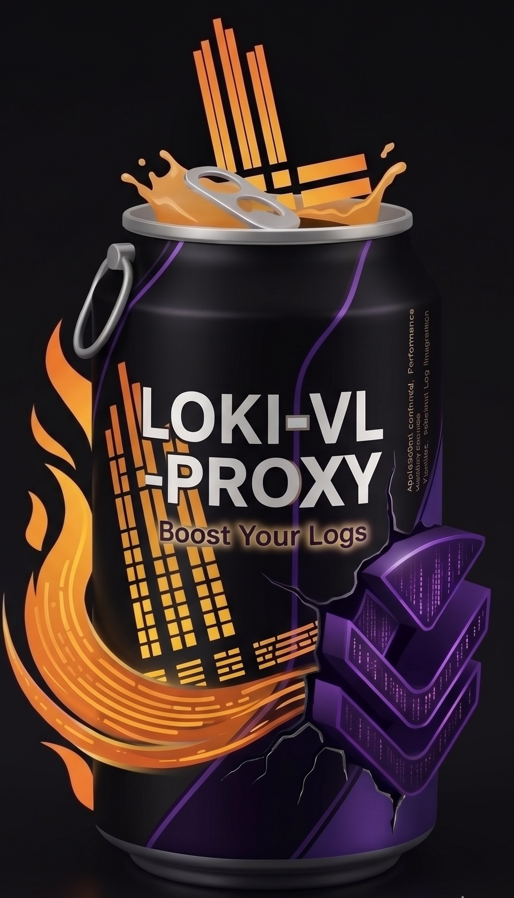
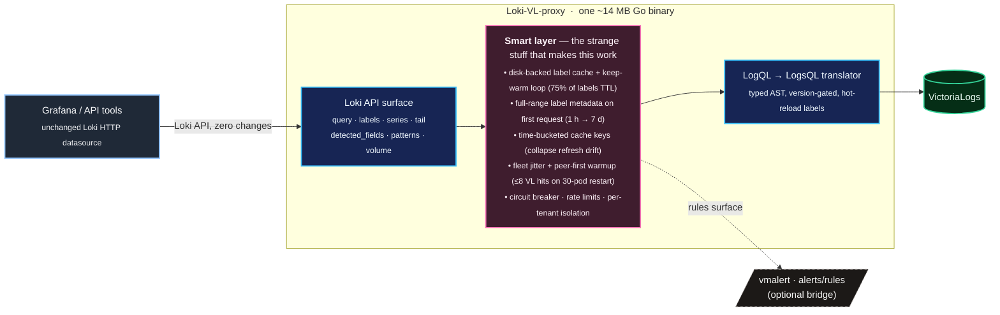
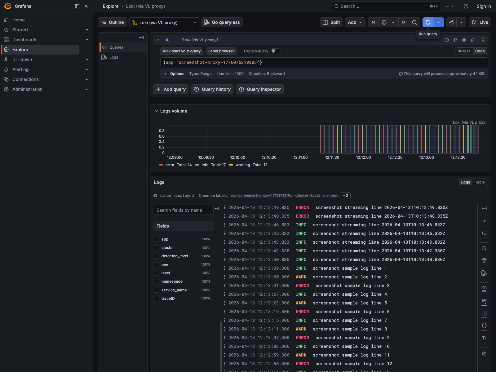
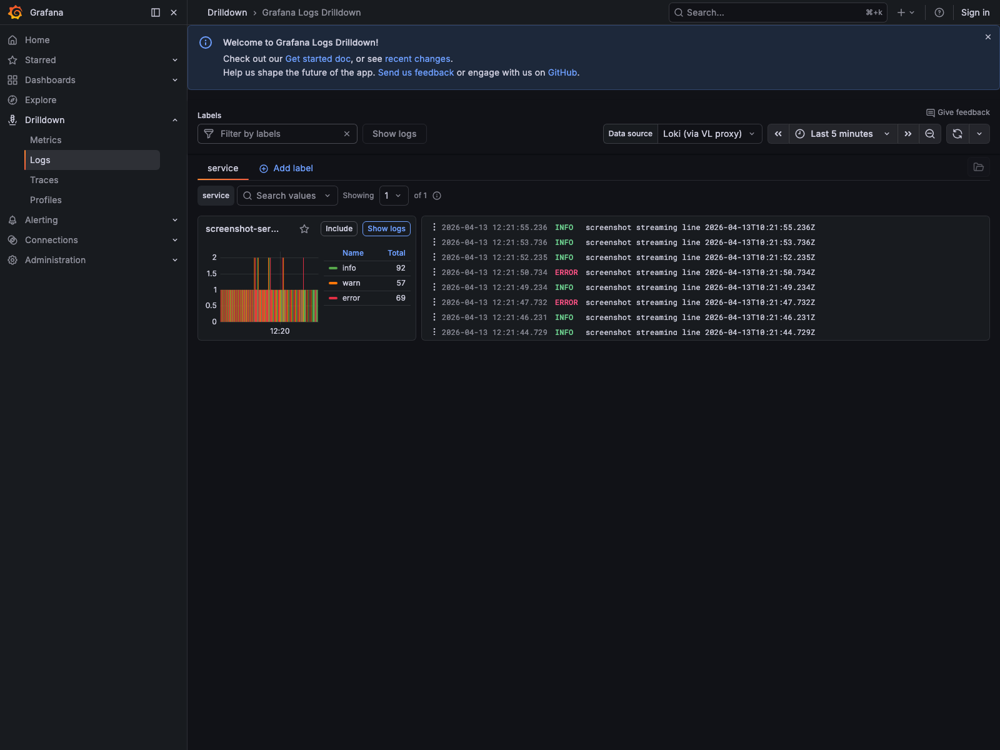
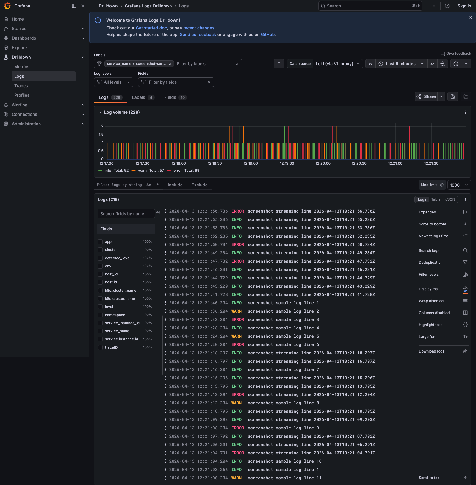
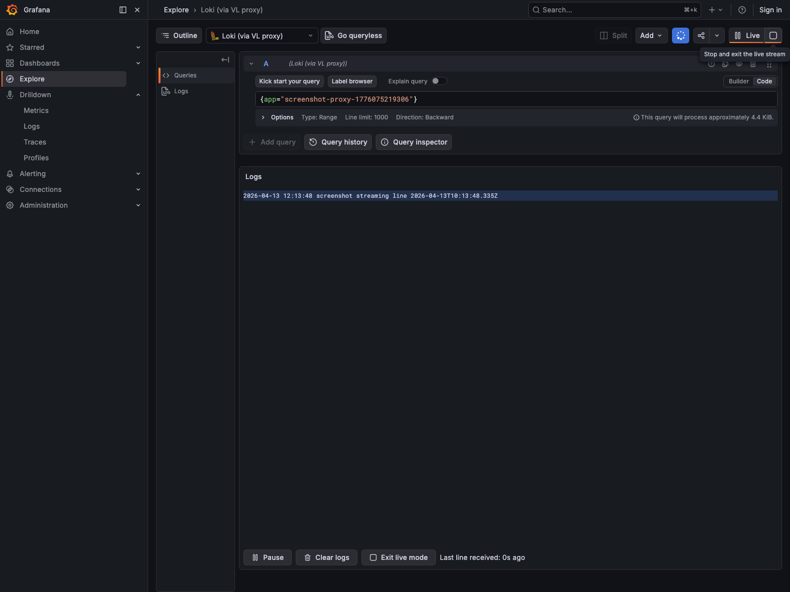

# Loki-VL-proxy

<p align="center">
  <picture>
    <source media="(prefers-color-scheme: dark)" srcset="website/static/img/loki-vl-proxy-logo-white.jpg">
    
  </picture>
</p>

[](https://github.com/ReliablyObserve/Loki-VL-proxy/actions/workflows/ci.yaml)
[](https://goreportcard.com/report/github.com/ReliablyObserve/Loki-VL-proxy)
[](https://github.com/ReliablyObserve/Loki-VL-proxy/actions/workflows/compat-loki.yaml)
[](https://github.com/ReliablyObserve/Loki-VL-proxy/actions/workflows/compat-drilldown.yaml)
[](https://github.com/ReliablyObserve/Loki-VL-proxy/actions/workflows/compat-vl.yaml)
[](https://go.dev/)
[](https://github.com/ReliablyObserve/Loki-VL-proxy/releases)
[](https://hub.docker.com/r/reliablyobserve/loki-vl-proxy)
[](https://github.com/ReliablyObserve/Loki-VL-proxy/pkgs/container/loki-vl-proxy)
[](https://github.com/ReliablyObserve/Loki-VL-proxy/pkgs/container/charts%2Floki-vl-proxy)
[](https://github.com/ReliablyObserve/Loki-VL-proxy)
[](https://github.com/ReliablyObserve/Loki-VL-proxy)
[](#tests)
[](#tests)
[](#logql-compatibility)
[](LICENSE)
[](https://github.com/ReliablyObserve/Loki-VL-proxy/actions/workflows/codeql.yaml)
[](https://scorecard.dev/viewer/?uri=github.com/ReliablyObserve/loki-vl-proxy)

📖 **Project site:** [reliablyobserve.github.io/Loki-VL-proxy](https://reliablyobserve.github.io/Loki-VL-proxy/) — full docs, benchmarks, runbooks, comparison matrix.

<details>
<summary><strong>How it works (TLDR)</strong></summary>

LogQL queries arrive → parsed into a typed AST (`internal/logql`) → translated into LogsQL via a typed builder (`internal/logsql`) → sent to VictoriaLogs.

Both parsers are hand-written recursive descent. The LogQL side handles the full Loki grammar. The LogsQL side uses a builder API that produces typed, syntactically valid LogsQL at construction time. Translation uses two tiers: stable string operations for well-understood paths (stream selectors, line filters), and typed AST construction for complex paths (stats aggregations, binary metric expressions, `PipeMath`/`PipeStats`/`PipeFilter` nodes).

**Label metadata — complete on the first response:** like Loki, `/labels` and `/label/{name}/values` return every label name and value with data in the requested range (1h → 7d) on the first request, from VictoriaLogs metadata calls over that whole range (sub-ms proxy overhead); repeated requests are served from cache. An empty answer is cached for only 30 seconds (or the disk or peer write-through minimum TTL, if higher) and, like any other answer, replaces the earlier cached answer in memory, on disk and on the owner peer, so newly ingested labels show up within 30 seconds and a vanished label set is not served again. Disk-backed cache survives proxy restarts; a keep-warm loop refreshes standard label windows at 75% of the labels TTL (`-labels-cache-ttl`, 5 minutes by default: about every 3m45s, skipping entries with more than 40% of that TTL left) so labels stay hot even with no user queries. Time-bucketed cache keys (5-min / 1h / 6h buckets by range) collapse dashboard refresh drift to the same entry. Label values come from `stream_field_values` on VictoriaLogs versions that support stream metadata endpoints and from `field_values` otherwise (or when `stream_field_values` rejects the request), after `field_names` resolves label aliases.

**Fleet restart safety:** rolling restarts of N proxy pods don't hammer VL. Startup jitter (`-warmup-max-jitter`) spreads instances across a configurable window; a two-phase peer discovery protocol (`/_cache/has` for batch presence check → `/_cache/get` from the freshest peer) means only the first instance per label window hits VL — the rest pull from peers. For a 30-pod fleet this reduces warmup VL queries from 120 to ≤8 on restart.

</details>

**Keep your entire Loki stack — Grafana Explore, Drilldown, dashboards, API tooling — and run it on VictoriaLogs.**

- **Drop-in Loki API.** Point your existing Grafana Loki datasource at the proxy. Zero plugin changes and no query rewrites for supported LogQL; measured gaps are listed in [compatibility gaps](docs/real-window-compatibility-gaps.md) and [Known Issues](docs/KNOWN_ISSUES.md).
- **Measured resource difference.** At 310 GiB/day ingest: VL + proxy runs on **1.4 cores and 6.1 GiB RAM**. Loki's published minimum for that ingest class: 38 cores, 59 GiB. That gap is real — not a benchmark artifact.
- **Proxy intelligence built in.** Disk-backed label cache with keep-warm loop, full-range metadata on the first response, time-bucketed keys, adaptive parallelism, circuit breaker, rate limits, tenant isolation. Fleet restart safety: jitter + peer-first warmup keeps rolling restarts from thundering VL. One ~14 MB static binary.

## Quality and performance vs Loki (current)

Measured against Loki v3.7.7 on the project's A/B stack: the same data, the same hardware. A pair is one query shape over one time range (1h to 7d); "comparable" means both sides answered and Loki's results cache did not answer the first request. The proxy serves Loki's read API; write endpoints such as push are not supported (ingest goes to VictoriaLogs directly); delete may be supported, and the alerting-rules API may come last; no other write endpoint is planned.

**Where the proxy is better than Loki**

- First request: **213 of 455** comparable pairs are faster (47%).
- Drilldown and Explore pages: **69 of 112** faster (62%); median first request **0.15 s** against Loki's **0.38 s**.
- Metric queries: **134 of 263** faster (51%); median first request **0.11 s** against **0.24 s**.
- Label and label-value calls: median repeat **0.01 s or less** against Loki's **0.03 s**, over 48 pairs.
- Near-now label lists (`/labels`, label values) answer within **100 ms**, at most **10 s** behind VictoriaLogs (a documented difference from Loki). Under 32 concurrent heavy queries, `/labels` p95 was **0.10 s to 0.14 s** against Loki's **6.2 s** on the same stack.

**Where it is on par**

- First request: **164 of 455** pairs are within noise (36%); noise is 25% and 50 ms.
- Log queries: **37 of 78** on par; metric queries: **104 of 263** on par; Drilldown and Explore pages: **23 of 112**.
- Repeat of the same query, median p50: Drilldown and Explore pages **0.04 s** against **0.05 s**, metric queries **0.03 s** against **0.02 s**, log queries **0.05 s** against **0.04 s**.
- Repeated and refreshed 6h metric windows (six shapes measured directly): **0.003 s to 0.023 s** against Loki's **0.005 s to 0.075 s**.
- Answers: **498 of 692** pairs return the same result as Loki (72%).
- Nested vector aggregations (for example `min by (zone) (avg by (pod, zone) (...))`) keep every level's grouping, like Loki.

**Where it is worse**

- First request: **78 of 455** pairs are slower (17%): log queries **32 of 78**, Drilldown and Explore pages **20 of 112**, metric queries **25 of 263**.
- **165 shape, range and mode rows are above 2x Loki** (and more than 50 ms slower): **55** on the first request and **110** on a repeat. Each is treated as a defect being fixed: the list only shrinks and a change that adds or worsens a row is flagged.
- Among the largest gaps, first request at 24h: `| json` queries that filter or group on `level_extracted`, **19.72 s** against **4.66 s**; `detected_level` volume over `| json`, **10.36 s to 10.40 s** against **1.02 s to 1.05 s** (the repeat is just as slow, **10.38 s** against **0.02 s**); Explore volume with two filters, **7.97 s** against **4.67 s**.
- Answers: **143 of 692** pairs return a different result from Loki, and **51** could not be compared.
- A 7d Drilldown breakdown can fail on the 64 MiB response budget where Loki answers (`limits/drilldown-7d-breakdown-response-limit`, open).

**Quality of the Loki read API**

| | Now |
|---|---|
| Loki endpoints the proxy routes | **23 of 33** (70%) |
| Endpoints with tests that compare the proxy against Loki | **18 of 33** (55%) |
| Endpoints whose registry state is `proven` | **11 of 33** (33%) |
| Routed endpoints answered natively by VictoriaLogs | 6 of 23 |
| Behaviour and feature items | 6 proven, 12 partial, 3 gaps |
| Known differences from Loki (ranked) | **87**: 67 open, 12 documented, 6 owner-kept, 2 upstream |

The five open differences with the most impact (all explore-visible): `profiles/keep-removes-derived-service-name` (`| keep` removes a `service_name` the proxy derived), `severity/detected-level-stage-side-effects` (`keep`, `drop` and a `detected_level` filter change other labels), `semantics/logfmt-existence-filter-ungrouped-sum` (an ungrouped sum over `| logfmt | key!=""` returns no series), `parsed-identity/bare-parser-metric-duplicates-extracted` (a bare `| json` metric labels each series with every parsed key twice) and `semantics/topk-bottomk-range-series` (`topk` and `bottomk` on `query_range` return k series overall, not per step). Differences kept on purpose are listed as documented or owner-kept, for example volume bytes (Loki counts chunk bytes, the proxy counts line bytes) and `| json` series identity (opt-in flag `-exact-parser-series-identity`).

Details, the per-workload tables and the method: [performance summary](conformance/reports/performance.md#summary-versus-loki) · [performance guide](docs/performance.md#current-position-versus-loki) · [ranked differences](conformance/reports/parity-gaps.md) · [coverage map](conformance/reports/coverage-map.md) · [Known Issues](docs/KNOWN_ISSUES.md).

---

## One-glance comparison

> **Historical, measured on an earlier release on the e2e stack with Loki given 12 GiB; not the current position.** For the current position see [Quality and performance vs Loki (current)](#quality-and-performance-vs-loki-current).

Measured 2026-06-05 on the included e2e stack — 36 cold Drilldown queries (`pod` / `trace_id` / `k8s_pod_name` / `service_version` / `/detected_fields` / `/labels` × 30 m – 24 h ranges) against `namespace=prod` (~5 000 pods, ~50 000 trace_ids/h, 8 M entries over 7 days). Loki given 12 GiB.

| | Loki direct | Proxy (+VL backend) |
|---|---:|---:|
| Cold queries returning real data | **9 / 36** (25 %) | **35 / 36** (97 %) |
| Silent fails (`HTTP 200 + result:[]`) | **13 / 36** ← blank Grafana panel | 0 |
| HTTP 500 / 502 / timeout | 14 / 36 | 1 (known VL `trace_id` 6 h limit) |
| Total CPU consumed | **2 713 cpu·s** (~45 cpu·min) | **5 cpu·s** + VL 117 cpu·s |
| Peak RSS | **10 445 MiB** | **44 MiB** + VL 2 129 MiB |

Proxy + VL together: **~140 cpu·s, ~2.2 GiB peak** for **97 %** of the workload. Loki: **~520× more CPU, ~190× more peak RSS** to serve **fewer than a quarter** of the same queries — the silent-empty bucket is the most user-hostile mode (Grafana shows a blank panel with no signal).

Full per-query breakdown, side-by-side latency table, methodology, and the heap-pool deep-dive: **[docs/honest-tldr.md](docs/honest-tldr.md)**. Reproduce: `./bench/drilldown-vs-loki.sh`. Raw TSV + pprof: `test/e2e-compat/results/`.

---

## Query Performance

Medians over the comparable pairs of the daily A/B against Loki v3.7.7 (generated: [performance summary](conformance/reports/performance.md#summary-versus-loki)). Cold is the first request; warm is the p50 of the repeats.

### Latency by workload

| Workload | Pairs compared | Cold faster / on par / slower | Proxy cold | Loki cold | Proxy warm | Loki warm |
|---|---:|:---:|---:|---:|---:|---:|
| Drilldown and Explore pages | 112 | 69 / 23 / 20 | 0.15 s | 0.38 s | 0.04 s | 0.05 s |
| Log queries | 78 | 9 / 37 / 32 | 0.10 s | 0.04 s | 0.05 s | 0.04 s |
| Metric queries | 263 | 134 / 104 / 25 | 0.11 s | 0.24 s | 0.03 s | 0.02 s |
| Metadata and label browser | 2 | 1 / 0 / 1 | 0.07 s | 0.07 s | 0.06 s | 0.05 s |

Loki's results cache answered 58 of the 60 metadata pairs, so they are listed apart.

### Label browser and Drilldown metadata

| Call | Pairs | Proxy cold | Loki cold | Proxy warm | Loki warm |
|---|---:|---:|---:|---:|---:|
| Labels (label browser) | 24 | 0.00 s | 0.03 s | 0.00 s | 0.03 s |
| Label values | 24 | 0.01 s | 0.04 s | 0.01 s | 0.03 s |
| Drilldown detected labels and fields | 8 | 0.01 s | 0.02 s | 0.00 s | 0.02 s |
| Volume (Drilldown landing) | 4 | 0.12 s | 0.13 s | 0.11 s | 0.11 s |

Medians over 1h to 7d; Loki's times are mostly its own cache hits.

### Translation overhead

LogQL to LogsQL translation takes **5.9 to 17.1 µs per query**. For a 100 to 500 ms VictoriaLogs round-trip this is under 0.02% of wall time.

| Query type | Time | Allocs |
|---|---:|---:|
| Selector `{app="nginx"}` | 7.3 µs | 22 |
| `rate({...}[5m])` | 8.0 µs | 54 |
| `sum(rate({...}[5m])) by (host)` | 5.9 µs | 47 |
| `ip("10.0.0.0/8")` filter (native `ipv4_range()`) | 7.8 µs | 41 |
| Binary metric `sum(rate) / sum(rate)` | 17.1 µs | 90 |

Median of 5 runs of `go test ./internal/translator/ -bench BenchmarkTranslate -benchmem -count=5` with `GOMAXPROCS=4` on an Apple M5 Pro (arm64), Go 1.27.3, on a host that was also running other work, so the times are an upper bound.

### Throughput under load (historical)

> **Historical: measured on proxy v1.50.0 with Loki 3.6.x and VictoriaLogs v1.50.0 using `loki-bench`; not re-measured.** It compares a warm, cache-assisted proxy with Loki on a synthetic mix and is not the current position. The method and the other throughput tables are in [Benchmarks](docs/benchmarks.md).

Measured with `loki-bench --jitter=2h --warmup=5s --duration=30s` on an Apple M5 Pro (18 cores, 64 GB RAM), ~8 M log entries across 15 services, 7-day window.

| Workload | Concurrency | Loki | Proxy | VL native | Proxy / Loki |
|---|:---:|---:|---:|---:|:---:|
| Small (metadata) | c=10 | 919 req/s | 2,785 req/s | 3,756 req/s | **3.0×** |
| Small (metadata) | c=50 | 726 req/s | 2,099 req/s | 3,793 req/s | **2.9×** |
| Small (metadata) | c=100 | 578 req/s | 1,822 req/s | 3,538 req/s | **3.2×** |
| Heavy (pipelines) | c=10 | 146 req/s | 483 req/s | 2,532 req/s | **3.3×** |
| Heavy (pipelines) | c=50 | 247 req/s | 582 req/s | 2,000 req/s | **2.4×** |
| Heavy (pipelines) | c=100 | 279 req/s | 568 req/s | 1,952 req/s | **2.0×** |
| Compute (rate, topk) | c=10 | 625 req/s | 629 req/s | 3,947 req/s | **parity** |
| Compute (rate, topk) | c=50 | 343 req/s† | 539 req/s | 4,338 req/s | **1.6×** |
| Compute (rate, topk) | c=100 | 410 req/s† | 468 req/s | 4,473 req/s | **1.1×** |

- **Small metadata:** 2.9–3.2× faster — VL label/series scans outperform Loki's chunk store, amplified by proxy cache.
- **Heavy pipelines:** 2.0–3.3× faster — `stats_query_range` fast path + response caching.
- **Compute:** parity at c=10; proxy dominates under pressure because Loki saturates.

† Loki compute c=50: **90.55% error rate** (saturated). c=100: **97.49% error rate**. Proxy: 0% errors at all concurrency levels.

### Dashboard load spikes — request coalescer

When many panels hit the same query simultaneously, the proxy collapses them into a single backend call. First-hit coalescing avoids the N-fan-out but pays one backend round-trip; subsequent hits are served from cache.

Full throughput tables, P90/P99 latency, CPU and RSS breakdowns: [Benchmarks](docs/benchmarks.md) · [Performance](docs/performance.md)

---

## The Cost Case

This is a production deployment, not a synthetic benchmark. The numbers below come from a real VictoriaLogs installation running at **310 GiB/day** raw ingest with **800 M total log entries** and **7.1 days** of retention.

**What VictoriaLogs actually consumed at that load:**

| Component | Cores | Memory |
|---|---:|---:|
| `vlstorage` | 1.0 | 5.0 GiB |
| `vlinsert` | 0.1 | 0.6 GiB |
| `vlselect` | 0.1 | 0.25 GiB |
| `loki-vl-proxy` | ~0.1–0.2 | ~0.15–0.26 GiB |
| **VL + loki-vl-proxy, combined** | **~1.4** | **~6.1 GiB** |

For comparison, [Loki's own documentation](https://grafana.com/docs/loki/latest/setup/size/) puts the **minimum** hardware requirement at **38 cores and 59 GiB** for the same ingest class (`<3 TB/day`). That's the floor — a minimal, single-tenant, non-HA deployment.

**Caveat:** `vlselect` was measured at zero read concurrency — query load will add to that number. If you run heavy aggregation queries at scale, benchmark your own workload with `loki-bench` before sizing.

**Storage:** 2,201 GiB of raw logs (310 GiB/day × 7.1 days) compressed to **40.5 GiB on disk — 54.9× compression**. TrueFoundry ran an independent migration and reported ~40% less storage versus their Loki deployment at the same retention.

**Replication:** Loki's recommended production setup uses RF=3 — tripling write load, disk, and cross-AZ egress. VictoriaLogs is designed for AZ-local deployment with no mandatory replication. If you're paying for cross-AZ data transfer today, that alone can outweigh compute savings.

**Migration cost:** Zero changes to Grafana, dashboards, alerts, or any Loki API client. The proxy handles translation transparently; remove it and point back at Loki if needed.

Full cost worksheet, scaling projections, and EC2/GCP sizing tables: [Cost Model](docs/cost-model.md) · [Scaling](docs/scaling.md)

---

## Supported versions

<!-- vl-support:start -->
| VictoriaLogs | Version |
|---|---|
| Supported | `v1.49.0` (the latest v1.4x release) and every v1.5x release |
| Tested in CI | `v1.49.0`, `v1.50.0`, `v1.51.1`, `v1.52.0`, `v1.53.0` |
| Pull-request CI pin | `v1.52.0` |
| Startup floor (`-backend-min-version`) | `v1.49.0` |
<!-- vl-support:end -->

The proxy refuses to start against a VictoriaLogs older than the floor unless `-backend-allow-unsupported-version=true` is set; such a version is unsupported and untested. Every supported minor is tested at its latest patch release that has a published image; the weekly matrix run includes the range-metric table compared with Loki. Loki, Grafana, Logs Drilldown and the Loki datasource plugin versions are listed in the [compatibility matrix](docs/compatibility-matrix.md); the VictoriaLogs policy and capability bands are in [VictoriaLogs compatibility](docs/compatibility-victorialogs.md).

---

## Quick Start

### Docker

```bash
docker run -p 3100:3100 \
  ghcr.io/reliablyobserve/loki-vl-proxy:2.25.0 \
  -backend=http://victorialogs:9428
```

Release images are signed; see [Verifying releases](SECURITY.md#verifying-releases) to check the signature and provenance before running one. Pin an explicit version tag, as above, rather than `latest`.

### Helm

```bash
helm install loki-vl-proxy oci://ghcr.io/reliablyobserve/charts/loki-vl-proxy \
  --version <release> \
  --set extraArgs.backend=http://victorialogs:9428 \
  --set extraArgs.patterns-enabled=true
```

### Grafana Datasource

Point your existing Loki datasource at the proxy — no other changes needed.

```yaml
datasources:
  - name: Loki (via VL proxy)
    type: loki
    access: proxy
    url: http://loki-vl-proxy:3100
    jsonData:
      httpHeaderName1: X-Scope-OrgID
    secureJsonData:
      httpHeaderValue1: team-alpha
```

That's it. Grafana Explore, Drilldown, and all dashboards work immediately.

For StatefulSet persistence, peer-cache fleet setup, OTLP push wiring, and image source options, see [Getting Started](docs/getting-started.md) and [Operations](docs/operations.md).

**Peer fleet discovery** — four modes, all refresh every 15 s and rebuild the hash ring live:

| Mode | Flag | Best for |
|------|------|----------|
| `dns` | `-peer-dns=proxy-headless.ns.svc.cluster.local` | Kubernetes headless service — only ready pods appear |
| `srv` | `-peer-srv=_loki-vl-proxy._tcp.proxy-headless.ns.svc.cluster.local` | Kubernetes StatefulSet, Consul DNS — port embedded in record |
| `http` | `-peer-http-url=http://consul:8500/v1/catalog/service/loki-vl-proxy` | Outside k8s: Consul, Nomad, Prometheus HTTP SD, or custom endpoint |
| `static` | `-peer-static=10.0.0.1:3100,10.0.0.2:3100` | Fixed fleets, development |

Verify the live ring at any time: `curl -H 'X-Peer-Token: <peer-auth-token>' http://proxy:3100/_cache/peers` → `{"peers":[...],"self":"...","count":N}` (peer endpoints require the shared token unless `-peer-insecure-ip-allowlist=true`).

Non-Kubernetes examples (static, Consul, Prometheus SD, CoreDNS) are in [`examples/peers/`](examples/peers/).

---

## Why It's Fast

**4-tier cache:**
- **Tier0** — compatibility-edge cache for safe GET responses (no backend hit at all)
- **L1** — in-memory hot path
- **L2** — disk (bbolt), survives restarts, warms historical windows across large working sets
- **L3** — peer cache, lets warm fleet replicas share results instead of all hitting the backend. Four peer discovery modes: `dns` (k8s headless A-records), `srv` (DNS SRV with embedded port, works with Consul DNS and k8s StatefulSets), `http` (polls any JSON endpoint — Consul catalog, Prometheus HTTP SD, custom registry), `static` (fixed list). Discovery refreshes every 15 s; the hash ring updates atomically so peer add/remove is live without restarts.

**Window reuse.** Long `query_range` requests are split into 1h windows. Historical windows are served from cache; only the live edge fetches from VictoriaLogs. A 7-day query with warm cache may hit the backend for a single window.

**Adaptive parallelism.** Parallel window fetches use EWMA-based backpressure — ramps up when VictoriaLogs is fast, backs off automatically before it becomes a problem.

**Request coalescing.** Concurrent identical queries collapse into one upstream request.

**Lock-free hot paths.** Circuit breaker, metrics histograms, and rate limiter use atomic operations instead of mutexes. Structured logging uses an async buffered handler. At 100+ concurrent requests, these eliminate the contention that dominates proxy-added latency.

---

## What Works Out of the Box

- Grafana Explore — log browsing, filtering, live tail
- Grafana Logs Drilldown — patterns, service view, field breakdown
- Dashboards — supported Loki log and metric queries
- Multi-tenant — `X-Scope-OrgID` isolation, including Loki-style `a|b` multi-tenant reads
- Live tail — native WebSocket tail or synthetic polling fallback
- Rules and alerts — read bridge to vmalert (no write lifecycle)
- LogQL — stream selectors, filters, parsers, metric queries, range functions and vector operators, with measured compatibility and documented limitations
- OTel labels — dotted structured metadata exposed correctly in detected fields, underscore-safe in stream labels

---

## Production Features

- **Circuit breaker** — opens on backend failure, closes automatically on recovery; lock-free fast path in healthy state
- **Per-client rate limits** — token bucket per client source IP plus a global in-flight cap (`-max-concurrent`, excess gets `503`)
- **Adaptive log sampling** — below 10 req/s logs everything; above it, OK traffic becomes periodic summaries while errors are always logged
- **Tenant isolation** — strict `X-Scope-OrgID` fanout guardrails; no cross-tenant data bleed
- **TLS / mTLS** — configurable on both northbound (client) and southbound (backend) boundaries
- **OTLP metrics push** — proxy pushes its own metrics to any OTLP HTTP endpoint
- **Operator dashboard** — packaged Grafana dashboard covering Client → Proxy → VictoriaLogs, cache behavior, fanout, and resource utilization
- **Runbook-backed alerts** — 15 alert rules, each with a linked runbook
- **100+ Prometheus metrics** — all under `loki_vl_proxy_*` prefix
- **Read-only by default** — `/push` returns `405`; `/loki/api/v1/delete` answers `404` like Loki unless `-delete-api-enabled` is set, and is not functional against current VictoriaLogs either way ([details](docs/security-hardening-migration.md#remaining-delete-api-gap)); debug/admin disabled unless explicitly enabled
- **Cold storage routing** — time-boundary split to Victoria Lakehouse for long-range queries
- **Query-length enforcement** — `query_range` time-range limit: global default via `-default-max-query-length`, per-tenant override via `max_query_length` in `-tenant-limits` / `-tenant-default-limits`

---

## How It Works



**What this picture says:** Grafana keeps talking Loki. The proxy translates LogQL to LogsQL on the way down, and the **Smart layer** is where the work happens — every entry in that pink box is what lets a 14 MB binary serve cold Drilldown queries that the official Loki layout can't run at all on 12 GiB RAM. The full per-box exploded view (10 subsystems, every handler, every cache tier, every backend) lives in [`docs/architecture.md`](docs/architecture.md) for operators and contributors.

---

## Compatibility

Loki-VL-proxy is validated continuously in CI against four compatibility contracts: Loki API, Grafana Logs Drilldown, Grafana Loki datasource, and VictoriaLogs integration.

### Label and Field Compatibility

| Profile | Stream labels (`/labels`) | Detected fields / metadata | Best for |
|---|---|---|---|
| Loki-compatible (default) | underscore-only | translated underscore aliases | strict Loki UX, Grafana Explore/Drilldown |
| Mixed | underscore-only | dotted + translated aliases | Grafana + OTel correlation |
| Native-field | underscore-only (`label-style=underscores`) | dotted-native only | VL/OTel-native field workflows |

Default flags: `-label-style=underscores`, `-metadata-field-mode=translated`. Grafana query builder works best with underscore aliases; code mode accepts dotted expressions and translates them to VL-native field matching.

**Tuple safety:** Default responses return strict `[timestamp, line]` 2-tuples. 3-tuple metadata mode activates only when the client sends `X-Loki-Response-Encoding-Flags: categorize-labels`. Cache keys are segregated by tuple mode.

### LogQL Compatibility

CI compares supported LogQL operations with a real Loki oracle. Strict populated-fixture regressions check labels, values, timestamps and errors in addition to the broader syntax/status suite. Correcting the exhaustive helper's timestamp units exposed gaps that its earlier scores missed; passing status or nonempty results does not establish complete LogQL parity. See the [measured findings and remaining limits](docs/real-window-compatibility-gaps.md).

**Typed LogQL parser:** The recursive-descent parser (`internal/logql`) produces a structured AST for validation, routing, and drop/keep extraction. It validates supported semantic constraints, including missing unwrap stages, invalid IP filter arguments and unclosed template delimiters. Grafana receives Loki-style error responses; the compatibility register records remaining syntax and runtime differences.

For full detail: [Loki Compatibility](docs/compatibility-loki.md), [Translation Reference](docs/translation-reference.md), [LogQL Parser](docs/logql-parser.md), [Known Issues](docs/KNOWN_ISSUES.md)

---

## Observability

- **100+ Prometheus metrics** under `loki_vl_proxy_*` — cache hit ratios, window fetch latency, fanout behavior, per-tenant and per-client pressure, circuit breaker state
- **Packaged operator dashboard** — rows for Client-Side Loki API Visibility, Proxy Internal, and Backend-Side VictoriaLogs fanout; fast incident attribution
- **15 runbook-backed alert rules** — backend latency, backend unreachable, circuit breaker open, high error rate, rate limiting, tenant error rate, tuple contract, system resources, and more
- **Structured JSON logs** — route-aware, semconv-aligned, with user-pattern attribution from trusted Grafana headers
- **OTLP metrics push** — the same proxy metrics pushed to any OTLP HTTP endpoint (`-otlp-endpoint`)

See [Observability](docs/observability.md) and [Alert Runbooks Index](docs/runbooks/alerts.md).

---

## Security

- Read-only API surface by default: `/push` blocked, debug/admin disabled; `/loki/api/v1/delete` answers `404` like Loki unless `-delete-api-enabled` is set, and is not functional against current VictoriaLogs ([details](docs/security-hardening-migration.md#remaining-delete-api-gap))
- Non-root runtime image, read-only root filesystem, restricted Helm security contexts
- Hardening headers on all HTTP responses including 404s and disabled routes
- CI security gates: `gitleaks`, `gosec`, Trivy, `actionlint`, `hadolint`, OpenSSF Scorecard, OWASP ZAP, curated Nuclei
- Proxy-specific coverage: tenant isolation, cache boundary enforcement, browser-origin checks on `/tail`, forwarded auth handling

See [Security](docs/security.md) and [Security Policy](SECURITY.md).

---

## UI Gallery

VictoriaLogs backend with Loki-VL-proxy as the Loki-compatible query layer.

<a href="docs/images/ui/explore-main.png">
  
</a>
<a href="docs/images/ui/explore-details.png">
  
</a>
<a href="docs/images/ui/drilldown-main.png">
  
</a>
<a href="docs/images/ui/drilldown-service.png">
  
</a>
<a href="docs/images/ui/explore-tail-multitenant.png">
  
</a>

---

## Documentation Map

### Core
- [Getting Started](docs/getting-started.md)
- [Configuration](docs/configuration.md)
- [Operations](docs/operations.md)
- [Architecture](docs/architecture.md)
- [API Reference](docs/api-reference.md)
- [Security](docs/security.md)
- [Observability](docs/observability.md)
- [Performance](docs/performance.md)
- [Scaling](docs/scaling.md)

### Compatibility
- [Compatibility Matrix](docs/compatibility-matrix.md)
- [Loki Compatibility](docs/compatibility-loki.md)
- [Logs Drilldown Compatibility](docs/compatibility-drilldown.md)
- [Grafana Loki Datasource Compatibility](docs/compatibility-grafana-datasource.md)
- [VictoriaLogs Compatibility](docs/compatibility-victorialogs.md)
- [Translation Modes Guide](docs/translation-modes.md)
- [Translation Reference](docs/translation-reference.md)

### Cache and Runtime Design
- [Fleet Cache](docs/fleet-cache.md)
- [Peer Cache Design](docs/peer-cache-design.md)
- [Benchmarks](docs/benchmarks.md)

### Runbooks
- [Alert Runbooks Index](docs/runbooks/alerts.md)
- [Deployment Best Practices](docs/runbooks/deployment-best-practices.md)
- [Backend High Latency](docs/runbooks/loki-vl-proxy-backend-high-latency.md)
- [Backend Unreachable](docs/runbooks/loki-vl-proxy-backend-unreachable.md)
- [Circuit Breaker Open](docs/runbooks/loki-vl-proxy-circuit-breaker-open.md)
- [Client Bad Request Burst](docs/runbooks/loki-vl-proxy-client-bad-request-burst.md)
- [Proxy Down](docs/runbooks/loki-vl-proxy-down.md)
- [Grafana Tuple Contract](docs/runbooks/loki-vl-proxy-grafana-tuple-contract.md)
- [High Error Rate](docs/runbooks/loki-vl-proxy-high-error-rate.md)
- [High Latency](docs/runbooks/loki-vl-proxy-high-latency.md)
- [Rate Limiting](docs/runbooks/loki-vl-proxy-rate-limiting.md)
- [Operational Resources](docs/runbooks/loki-vl-proxy-system-resources.md)
- [Tenant High Error Rate](docs/runbooks/loki-vl-proxy-tenant-high-error-rate.md)

### Testing and Release
- [Testing](docs/testing.md)
- [Release Info](docs/release-info.md)

### Migration and Project Status
- [Rules And Alerts Migration](docs/rules-alerts-migration.md)
- [Known Issues](docs/KNOWN_ISSUES.md)
- [Roadmap](docs/roadmap.md)
- [Changelog](CHANGELOG.md)

---

## License

Apache License 2.0. See [LICENSE](LICENSE).
