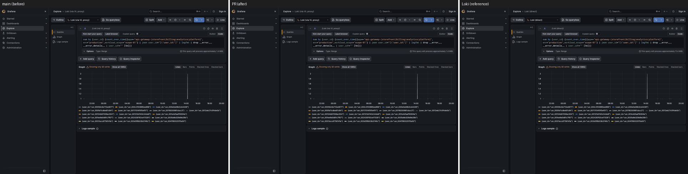

# Mixed-parser metrics: current native execution against a forced-RAW control

Measured **2026-11-23**, on the existing dual-written normal-generator stack:
Apple M5 Pro, Go 1.27.4, Loki 3.7.10 and VictoriaLogs 1.54.0.
**All 432 complete answers pass 108 four-way comparisons. Normal native cold
requests remain slower than main; forward updates improve against main.
Forced RAW is an investigation control, not a release candidate.**

## Source identities and method

Main is `895c23078f4afa12fe0a1200f8138a32f0b7f76a`. The normal candidate source
manifest is `fb2b09872464d502a75ddc86fbec9207474bcfc3095f83cf96c3f9c60860e740`;
the forced-RAW diagnostic is
`ed598140ac52f8093d16a9eac108780ca20cc2248ad22a41060757b752a58b5b`.
The collector label **`previous` means forced RAW in this run**, never the prior
release or the previous dated E247/FF5 source. Only the mixed native execution
admission differs in that diagnostic. [Source and method](source-and-method.json)
retain both source identities, the changed file hashes, 426 production Go file
hashes plus go.mod/go.sum, and a verified production-source audit.

This proof reuses `bench/ab/perf_matrix.py`,
[typed-matrix-derived shapes](shapes.json) and the [runtime plan](runtime-plan.json).
Six rounds rotate main, normal and RAW order; Loki is the fourth reference.
Each shape/range starts with that proxy's memory/SSD tiers flushed and has two
60-second forward updates. Peers are disabled. Disk caches have separate
**128 MiB logical capacities**, not physical file-size guarantees. Loki results,
backend and OS caches are not reset. Historical bounds, steps and every
resource/cache sample remain in the six retained `api-round-N.json` files.
The selector limits this experiment to `workload_scope="scope-01"`.
The existing backend volumes and generator were preserved, and all measured
service images, commands, users and mounts were restored and verified.

## Answer quality and latency

[Summary](summary.json) reports **432 HTTP 200 responses and 108/108 matching
complete-answer comparisons** across main, normal, RAW and direct Loki.
[Answer digests](answer-digests.json) retain canonical full-answer hashes,
request identities, labels/point-derived counts and status; raw full response
bodies are omitted. Canonical comparison checks labels, timestamps and values,
not merely series counts or an aggregate signature.

Medians in milliseconds; first request has six samples per target/cell, forward
update has twelve.

| Parser / range | First main / normal / forced RAW | Forward update main / normal / forced RAW |
|---|---:|---:|
| JSON → logfmt, 1h | 31 / 37 / 65.5 ms | 20 / 15 / 12 ms |
| JSON → logfmt, 6h | 85.5 / 155 / 743 ms | 57 / 37 / 36.5 ms |
| JSON → logfmt, 24h | 151 / 225 / 871.5 ms | 71.5 / 36 / 33.5 ms |
| logfmt → JSON, 1h | 28 / 36 / 64 ms | 19.5 / 14.5 / 12 ms |
| logfmt → JSON, 6h | 89 / 149.5 / 700 ms | 56.5 / 39 / 36 ms |
| logfmt → JSON, 24h | 145.5 / 234 / 940.5 ms | 70.5 / 35.5 / 34 ms |

Native execution materially lowers first-request CPU and decoded VL bytes
against forced RAW, but it does **not** clear the regression against main.
Forward updates benefit from reuse on both candidate variants; the RAW control
is sometimes slightly quicker on these updates. No claim that every warm query
is faster than Loki follows from this experiment.

## CPU, memory, backend bytes and calls

CPU is a first-request process-counter delta, including possible background
work. RSS is the maximum sampled process RSS across that cell's requests,
not exact peak or retained heap.

| Parser / range | First CPU main / normal / RAW | Maximum sampled RSS main / normal / RAW |
|---|---:|---:|
| JSON → logfmt, 1h | 18.7 / 23.0 / 77.3 ms | 158.0 / 166.8 / 165.7 MiB |
| JSON → logfmt, 6h | 45.2 / 69.5 / 789.0 ms | 147.6 / 195.0 / 191.4 MiB |
| JSON → logfmt, 24h | 43.0 / 62.8 / 896.4 ms | 147.6 / 235.0 / 217.5 MiB |
| logfmt → JSON, 1h | 12.8 / 23.7 / 75.3 ms | 146.5 / 180.2 / 166.8 MiB |
| logfmt → JSON, 6h | 42.8 / 67.8 / 736.3 ms | 158.3 / 197.6 / 191.1 MiB |
| logfmt → JSON, 24h | 43.9 / 69.5 / 971.3 ms | 158.3 / 227.1 / 191.1 MiB |

Request-scoped VL-call headers usually show 3 / 1 / 1 calls for main / normal /
RAW. Discovery adds calls in some first/refresh requests; every observed count
remains in the collector files and summary. The byte reduction against RAW
does not imply a reduction in call count against RAW.

Per first request, median decoded VL bytes for main / normal / RAW are:

| Range | Main | Normal native | Forced RAW |
|---|---:|---:|---:|
| 1 h | 119,213 | 111,164 | 1,916,475 |
| 6 h | 651,376 | 608,221 | 11,056,691 |
| 24 h | 1,252,421 | 1,169,012 | 20,724,581 |

These are decoded input bytes, not encoded network bytes or physical SSD
throughput. Request-scoped backend headers usually show 3 calls on main and
1 on either candidate; discovery calls and other outliers remain in the raw
rounds and summary, so there is no unconditional one-call claim. Loki-output
and VL-input cache counters remain distinct in each collector row.

One candidate reverse-parser 6 h update lacks its resource sample; latency and
answer evidence remain. Physical IOPS, SSD throughput, evictions, per-query VL
CPU, pressure/failover, disk-restart and exact-repeat acceptance were not
measured. Higher normal-candidate sampled RSS than main remains visible;
this run does not establish a memory reduction.

## Variability: retain all samples

The table lists all six first-request samples in recorded round order, in ms.
Order rotates; these are not six independent dedicated-host experiments.

| Parser / range | Main: six first requests | Normal: six first requests | Forced RAW: six first requests |
|---|---|---|---|
| JSON → logfmt, 1h | 59; 30; 200; 29; 32; 29 | 48; 37; 202; 31; 32; 37 | 84; 59; 444; 61; 70; 57 |
| JSON → logfmt, 6h | 85; 81; 702; 87; 86; 82 | 184; 161; 1658; 149; 147; 141 | 675; 866; 5151; 811; 645; 660 |
| JSON → logfmt, 24h | 159; 157; 1021; 139; 137; 145 | 216; 233; 1874; 226; 224; 217 | 932; 861; 1359; 867; 876; 862 |
| logfmt → JSON, 1h | 27; 48; 37; 27; 29; 27 | 36; 59; 43; 36; 34; 35 | 63; 97; 81; 65; 59; 63 |
| logfmt → JSON, 6h | 83; 94; 260; 87; 85; 91 | 151; 150; 149; 139; 143; 163 | 701; 966; 724; 682; 669; 699 |
| logfmt → JSON, 24h | 144; 140; 147; 139; 215; 151 | 233; 234; 239; 234; 300; 229 | 936; 1132; 952; 895; 945; 931 |

Round 2 has large delays across several targets. A direct-Loki reverse-parser
6 h update took **290.637 s**. Its cause is unproved, the sample remains retained,
and it is not used to claim a proxy speedup.
[Measurement limits](measurement-limits.json) retain the outliers and missing
resource sample explicitly. Specifically, one normal-candidate reverse-parser
6 h forward update has no reuse/resource sample. **Data parity passes separately;
resource evidence is incomplete and complete performance acceptance is not
established.** Medians do not erase these limits.

The [earlier E247 evidence](../2026-11-23-mixed-point-encoding/README.md) remains
dated and unchanged: its API numbers and browser captures belong to E247, not
this normal source. The corresponding current-source native Grafana capture is now documented
below. This API control does not establish all-values Show all, complete
Fields/Labels scrolling, 48 h browser UX or a passing full CI run. At collection, the normal changes were unpublished and the published head was
`1394975520d86369b0d632473ec4e1800c55ff62`. These local results do not supersede
that revision's CI failures; subsequent CI status is reported in the pull request.

## Current normal-source native Grafana evidence

The FB2B source now has **24 completed native Grafana captures, eight
main/normal/Loki triples**, using the existing capture/comparison harness.
[The plan](browser/plan.json) keeps runtime/resource proof required. All eight
comparisons settle with no recorded runtime problems, API errors or panel
errors; the comparator exits 0. Service restoration and preservation of backend
volumes/generator are verified in the
[selected artifact manifest](browser/artifact-manifest.json).

Main/normal captured responses compare identically for all three requests per
triple. Against Loki, one of three captured requests compares identically and
two auxiliary resource responses (`index/stats` and labels) differ in each
triple. These **16 differences remain visible** in the
[comparison report](browser/compare.md) and
[full structured runtime comparison](browser/compare.json). This is not full
Loki resource compatibility, and screenshots do not replace exact-answer API
proof.

| Native Explore / range | First API data main / normal | Browser task duration main / normal | Max sampled JS heap main / normal |
|---|---:|---:|---:|
| general count control, 24h | 725 / 720 ms | 592.7 / 591.8 ms | 47.8 / 50.6 MiB |
| general count control, 6h | 726 / 762 ms | 592.3 / 634.9 ms | 51.8 / 52.4 MiB |
| parser explicit count, 1h | 970 / 753 ms | 709.6 / 645.2 ms | 65.2 / 61.1 MiB |
| parser explicit count, 24h | 733 / 751 ms | 741.3 / 756.0 ms | 71.6 / 67.3 MiB |
| parser explicit count, 6h | 731 / 724 ms | 700.4 / 694.0 ms | 77.5 / 61.9 MiB |
| parser reverse count, 1h | 715 / 728 ms | 612.5 / 641.0 ms | 60.1 / 67.3 MiB |
| parser reverse count, 24h | 719 / 737 ms | 737.2 / 749.5 ms | 72.5 / 51.4 MiB |
| parser reverse count, 6h | 734 / 737 ms | 668.1 / 692.9 ms | 77.2 / 77.1 MiB |

These are single captured visits per cell, not repeated UX latency percentiles.
Browser task duration and sampled JS heap are client-side measurements, not Grafana
server/proxy CPU or RSS. The structured comparison also retains first-data and
settle times, request/transfer sizes and aborted/unfinished work. Settle includes
the harness stability wait. Some visits cost more than main, so there is no
general UX or memory-reduction claim.

[Pixel differences](browser/pixeldiff.json) between main and normal are at most
**0.016%**. Representative native Explore 24 h comparison: main, normal, Loki.

The manifest lists all eight montages and three selected full-size 24 h
screenshots with hashes. Capture verdict logs are retained for
[main](browser/capture-main.log), [normal](browser/capture-pr.log) and
[Loki](browser/capture-loki.log). The default graph still shows its normal series
limit. **Full Show all, complete Fields/Labels scrolling and 48 h browser UX
remain unproved**; the existing runtime/resource gate is retained.
