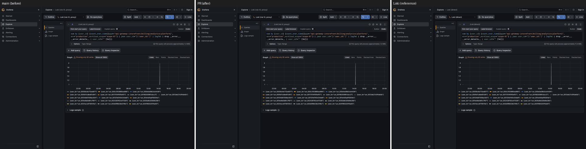

# Mixed-parser metrics: integer point encoding and native Grafana evidence

Measured **2026-11-23**, Apple M5 Pro, Go 1.27.4, Loki 3.7.10 and VictoriaLogs
1.54.0, using the existing stack and dual-written normal-generator data.
**Cold requests still regress against main; moving-window refreshes are faster.
This is scoped evidence, not whole-Drilldown acceptance or a passing current-head
CI report.**

## Sources and method

Main is `895c23078f4afa12fe0a1200f8138a32f0b7f76a`. Previous and candidate are
immutable, uncommitted build-source manifests
`ff5dc9f57a0e4f4741f5fe9d7d3d628fdc67c18c36ea539298af1b8b6a8491df` and
`e247c9ecbabe6ace0d3b3987002050f0924ec35063988f50f0b8bb921059e242`.
[Source and method](source-and-method.json) retains per-file product source hashes,
the base commit, publication head and image identity. A later source change needs
new evidence; these results do not automatically describe that change.

The candidate uses integer encoding for count points while retaining floating
point rate output. Both previous and candidate already include the native row
partition, raw complement and cancellation-channel reuse measured in the
[previous dated run](../2026-11-22-mixed-native-cold/README.md).

The existing `bench/ab/perf_matrix.py` collector ran six rounds, rotating target
order, for two typed-matrix-derived queries at 1 h, 6 h and 24 h. Each first
request starts after flushing that proxy's memory and disk cache tiers, followed
by two 60-second forward updates. Peers are disabled. Each measured proxy has a
separate disk cache configured for **128 MiB logical capacity**, not a physical
file-size bound. Loki's results cache, backend caches and OS caches are not
cleared; direct-Loki timings are reference observations, not cold-Loki claims.
The selector includes `workload_scope="scope-01"`; it does not replace the
unscoped workload. Queries, time steps, fixed end, resource samples and requests
are retained in [shapes](count/shapes.json), [runtime plan](count/runtime-plan.json)
and [collector rounds](count/api-rounds.json).

## Complete answers and API latency

All **432 responses returned 200**, with **108/108 four-way full-answer comparisons
matching** across main, previous, candidate and direct Loki. Comparisons include
canonical labels, timestamps and values for the first request and every update;
they do not rely on a series count or aggregate signature alone.
[Answer digests](count/answer-digests.json) retain identities, hashes and
series/point counts without committing the large response bodies.
[Summary](count/summary.json) retains failures and per-target medians.

| Parser order / range | First main / previous / candidate | Forward update main / previous / candidate |
|---|---:|---:|
| JSON → logfmt, 1h | 28.5 / 42.5 / 34.5 ms | 20 / 13.5 / 14 ms |
| JSON → logfmt, 6h | 84 / 162 / 141 ms | 53.5 / 34.5 / 35 ms |
| JSON → logfmt, 24h | 133.5 / 222 / 221.5 ms | 71 / 35 / 34.5 ms |
| logfmt → JSON, 1h | 27.5 / 37 / 32.5 ms | 19 / 13 / 13 ms |
| logfmt → JSON, 6h | 84.5 / 152 / 145 ms | 54.5 / 34.5 / 37 ms |
| logfmt → JSON, 24h | 139.5 / 231 / 214.5 ms | 67.5 / 34 / 33.5 ms |

Candidate first-request medians are lower than previous in all six cells,
but the 24 h JSON → logfmt result is effectively unchanged (222 → 221.5 ms).
Every candidate first-request median remains slower than main. Candidate refresh
medians are 27–51% below main in these six cells. A few samples and a shared host
do not establish a general latency guarantee; all individual cold samples remain
in the summary.

## CPU, memory and backend cost

The CPU column is the median first-request process-counter delta; RSS is the
maximum sampled process RSS across that cell's requests.

| Parser order / range | First CPU main / previous / candidate | Maximum sampled RSS main / previous / candidate |
|---|---:|---:|
| JSON → logfmt, 1h | 14.4 / 27.4 / 15.2 ms | 157.1 / 163.2 / 173.8 MiB |
| JSON → logfmt, 6h | 42.1 / 81.6 / 58.6 ms | 165.9 / 185.1 / 167.6 MiB |
| JSON → logfmt, 24h | 39.0 / 57.4 / 52.2 ms | 168.9 / 199.1 / 199.4 MiB |
| logfmt → JSON, 1h | 12.4 / 23.7 / 17.2 ms | 168.9 / 199.1 / 154.2 MiB |
| logfmt → JSON, 6h | 40.7 / 77.0 / 64.4 ms | 170.4 / 187.0 / 184.3 MiB |
| logfmt → JSON, 24h | 40.4 / 55.8 / 51.6 ms | 170.4 / 218.8 / 211.9 MiB |

These are sparse samples, not exact memory peaks or retained heap, and process
CPU deltas may include background work. They do not prove a general memory
reduction. Request-scoped VL-call headers usually show **3 calls on main versus
1 on previous/candidate**. Discovery calls and one refresh outlier remain visible
in the retained samples; there is no blanket one-call claim.

Candidate decoded VL bytes equal previous: 111,164 / 608,221 / 1,169,012 bytes
for first requests at 1 h / 6 h / 24 h, versus main's
119,213 / 651,376 / 1,252,421. These are decoded backend bytes, not network or
physical SSD throughput. Loki-output and VL-input cache counters remain separate
in the collector artifacts. This run does not measure physical IOPS, evictions,
fleet pressure, disk restart, exact repeats, owner loss or per-query VL CPU.

The isolated [count/rate reducer benchmark](cold6-integer-benchstat.txt) uses six
samples: count improves 16.614 → 9.930 ms (-40.23%, p=0.002); rate is unchanged
within noise, 16.00 → 16.02 ms (p=0.818). B/op and allocations are unchanged.
These numbers exclude backend reads and HTTP work and do not clear the cold API
regression. [Before](cold6-integer-bench-before.txt),
[after](cold6-integer-bench-after.txt) and
[publication transformations](publication-transformations.json) preserve the
measurements and describe removal of local paths from table headings.

## Rate and extended-range controls: failures retained

The one-round rate control returned 72 responses. The existing shared Go
`test/metricparity.DecodeSamples` / `Difference` contract compared every label,
timestamp and value against Loki: **candidate 18/18 and previous 18/18 pass**;
**main fails all 18 comparisons with missing grouped series**. The
[shared-Go report](rate-control/shared-go-parity.json) deliberately retains its
**global `passed: false`**. Candidate parity is not a four-way global pass.
[Rate requests](rate-control/api-rounds.json) and
[digests](rate-control/answer-digests.json) preserve the separate control.

The one-round [extended control](extended-control/summary.json) covers
12 h, 18 h and 48 h; 48 h uses a 120-second step. The six-round count suite above
covers 24 h. Extended **full-answer acceptance remains FAIL**: the three proxies
agree, but direct Loki differs at 48 h. Loki's 36 h retention and old-sample
rejection leave different source data from VL. The retained
[source-window diagnostic](extended-control/source-window-diagnostic.json)
shows 10,838 proxy-only series, zero Loki-only series and 394 shared series with
different points for the inspected answer. The
[alignment diagnostic](extended-control/alignment-diagnostic.json) is also
retained. These explain an investigation boundary; they do not waive a mismatch
or establish complete live 48 h compatibility. The original global failure
and its artifacts remain unchanged. Extended single-round timings are
observations, not a repeated performance gate.

A separate **identical-source 48 h count oracle now passes**. The existing
`TestOrderedMixedStatsActualRangeMatchesRecordedLoki` completed in **81.79 s**;
its [unmodified test log](real48/engine-full-proof.log),
[live-source audit receipt](real48/receipt.json),
[request identities](real48/requests.json) and
[source/method with artifact hashes](real48/source-and-method.json) distinguish
the two checks:

| Check | Input and comparisons | Result |
|---|---|---|
| Pinned Loki v3.7.10 engine against live Loki, fixed retained 24 h | Count and rate in both parser orders; 4 requests; all 14,828 input rows audited before and after | PASS |
| Retained E247 complete 48 h count responses against pinned engine | Both parser orders and their forward updates; 6 requests; the identical complete 39,321-row VL source | PASS |
| Original live direct-Loki comparison over 48 h | Different retained source data under Loki's 36 h policy | FAIL, unchanged |

The [source metadata](../../../../../internal/proxy/testdata/loki_engine/ordered_mixed_real48_source.json)
and [compressed source fixture](../../../../../internal/proxy/testdata/loki_engine/ordered_mixed_real48_source.jsonl.gz)
retain the real generator rows and provenance for replay. This semantic proof
does not assert live retention equality, 48 h rate parity, browser responsiveness
or full Fields/Labels acceptance. The existing oracle test entry point is reused.
The original receipt's pending-integration note records that checkpoint; the
later golden append and local validation are documented below. Neither local
PASS is a fresh full-CI PASS.

The dated cold measurements above remain tied to E247. The later envelope-budget
fix and reducer helper extraction are outside that measured manifest; their
local verification does not remeasure current-source cold performance.

## Later verification: separate from the E247 measurements

The [later-verification summary](later-verification/summary.json) retains source
log hashes, selected source-file hashes, verdict counts and artifact chronology.
The subsequent frozen normal source is
`fb2b09872464d502a75ddc86fbec9207474bcfc3095f83cf96c3f9c60860e740`;
the local audit confirms all **426 production Go files** match that freeze.
This identity is not substituted for E247 in the API tables above. Changes remain
unpublished, and the latest published head
`1394975520d86369b0d632473ec4e1800c55ff62` still has its prior failing CI;
a fresh full CI run on the updated source is outstanding.

| Verification stage | Recorded result | Scope and limit |
|---|---|---|
| Full unit/coverage run, before reducer extraction | **FAIL**, exit 1; 43 packages PASS, 1 SKIP, 1 FAIL; 61,456 test verdicts PASS, 119 SKIP, 1 FAIL; coverage 92.0% | Only failure: classifier metadata missing on 25 new YAML cases. Coverage and counts are dated to this run. |
| Classifier corrected; dedicated caseverify rerun | PASS, 0.624 s | Repairs that failure; does not turn the original full run into PASS or rerun every package. |
| Real Loki/VL checks before helper extraction | Five top-level tests PASS, 89.26 s | Actual backend checks use the intended cache configuration. |
| Real check after helper extraction | PASS, 49.81 s | Fresh 82-record pinned-Loki oracle plus VL 1.49.0/1.54.0, including retained full-48 h source. |
| Final focused race run | PASS, 2.209 s | Focused scope; two live-backend tests skip here and have separate actual-backend runs. |
| Pinned lint after helper extraction | 0 issues | Both extracted helpers are reported inlineable by the compiler. |
| Six paired reducer benchmark samples per function | Count median +0.08%; rate +0.94%; allocation counts unchanged | No speedup claim; excludes backend and HTTP costs. |

The original full-run [exit receipt](later-verification/unit-exit.json) and
[classifier failure extract](later-verification/unit-verdicts.log) remain
alongside the [dedicated passing rerun](later-verification/caseverify-fixed-verdicts.log).
[Actual-backend verdicts](later-verification/actual-loki-vl-verdicts.log),
[post-extraction actual verdicts](later-verification/post-refactor-actual-verdicts.log)
and [focused race verdicts](later-verification/final-focused-race-verdicts.log)
keep those proofs distinct. The
[lint result](later-verification/reducer-lint-refactor-pinned-lint.log),
[compiler extract](later-verification/reducer-lint-refactor-focused-extract.log)
and [paired benchmark samples](later-verification/reducer-lint-refactor-benchmark-summary.json)
document the refactor without claiming a user-visible improvement.

The envelope-budget regression has preserved
[RED](later-verification/envelope-red-extract.log) and
[GREEN](later-verification/envelope-green.log) evidence: the 276-byte original row
passes a 295-byte original-input cap despite a 314-byte envelope, and the
275-byte rejecting cap remains enforced. The fix preserves the byte limit.

The [golden append receipt](later-verification/catalog-append-receipt.json)
confirms **72 existing records retained byte-for-byte as a prefix, 82 total**:
four live-24 h overlap records and six full-48 h count records were appended.
This extends existing oracle coverage; it does not erase the original
live-48 h retention mismatch or establish full-48 h rate/UX compatibility.

## Existing live matrix and native Grafana

The existing `TestQuerySemanticsMatrix` passes **242/242 cases** on the candidate.
[Matrix result](matrix-result.json) retains each case ID, final verdict, source
log hash and verified service restoration. The corrected isolated test profile
explicitly enables numeric-tenant passthrough, matching the existing matrix;
the initial private profile omitted it and failed. This is a test-profile
correction, not a product-default change or a replacement for real oracle tests.

The existing `bench/visual/capture.spec.ts` and `bench/visual/compare.py` captured
**24 native Grafana pages: eight main/candidate/Loki triples**, using required
runtime/resource proof in [the plan](browser/plan.json). All captures settled;
there are no recorded runtime problems, API errors or panel errors in these
scoped captures. Main/candidate responses match for all three captured requests
per page. The comparator retains two auxiliary resource differences per triple
against Loki (`index/stats` and label discovery), so this is **not complete
Loki resource parity**. [Comparison](browser/compare.md) and
[structured resource measurements](browser/compare.json) retain these findings.

| Native Explore capture | First API data main / candidate | Settled main / candidate |
|---|---:|---:|
| general count control, 24h | 746 / 734 ms | 4.024 / 4.021 s |
| general count control, 6h | 723 / 710 ms | 4.015 / 4.017 s |
| parser explicit count, 1h | 863 / 765 ms | 4.545 / 4.031 s |
| parser explicit count, 24h | 730 / 732 ms | 4.518 / 5.02 s |
| parser explicit count, 6h | 731 / 733 ms | 4.521 / 4.523 s |
| parser reverse count, 1h | 725 / 729 ms | 4.016 / 4.019 s |
| parser reverse count, 24h | 733 / 740 ms | 4.52 / 4.514 s |
| parser reverse count, 6h | 738 / 725 ms | 4.026 / 4.02 s |

The settle time includes the harness's stability wait and is not a measurement
of first paint. Maximum sampled candidate JS heap is 93.7 MiB in these captures;
this is neither Grafana server RSS nor proof for an unscoped Fields page.
[Main/candidate pixel differences](browser/pixeldiff.json) are at most **0.016%**.
Screenshots do not prove all-series data parity. The captured default graph
still displays its normal series limit: **full Show all, all values, complete
Fields/Labels scrolling, 48 h browser UX and the original heavy workload are not
accepted by this run**. The runtime/resource gate remains required.

Representative native 24 h Explore comparison, left main, centre candidate,
right Loki:

All eight comparison montages and selected full-size 24 h screenshots are listed
with original hashes in the [browser artifact manifest](browser/artifact-manifest.json).
The 24 capture verdicts are retained in
[main](browser/capture-main.log), [candidate](browser/capture-pr.log) and
[Loki](browser/capture-loki.log) logs. No full query response bodies or new benchmark harness
were added for this publication.
