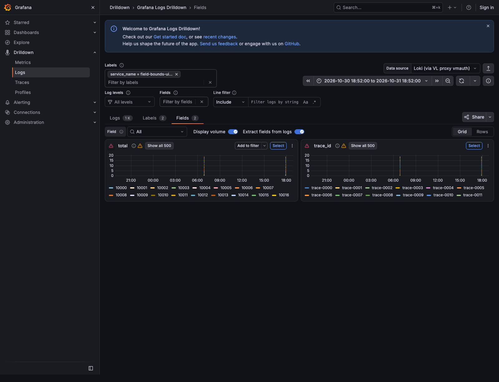
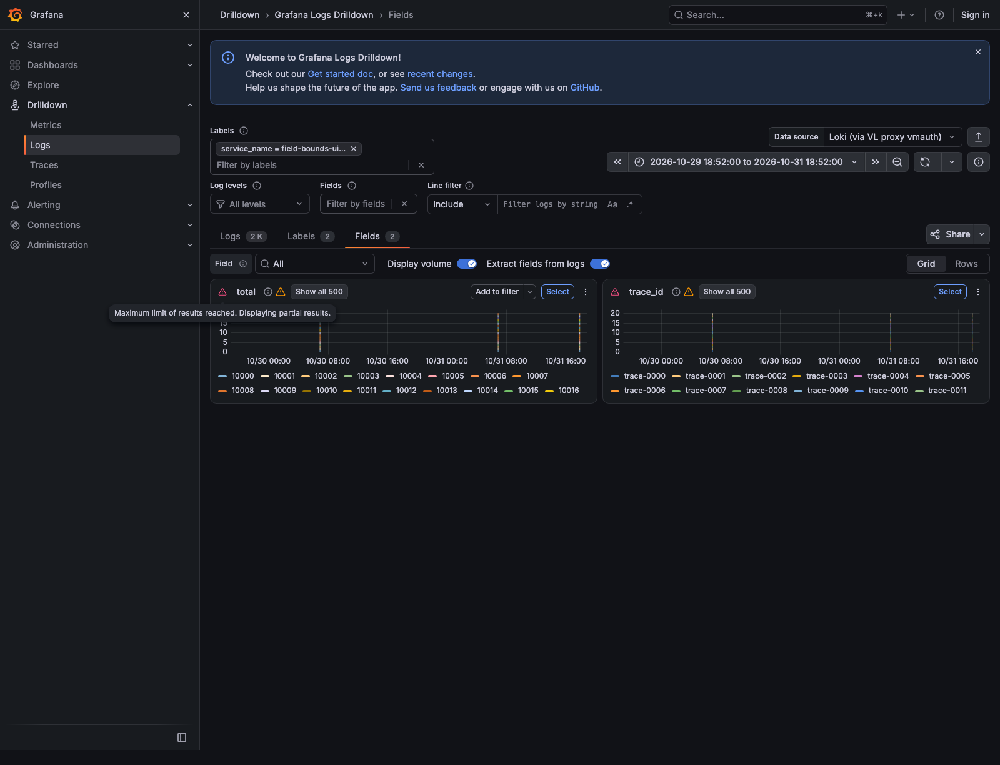

# Bounded Drilldown Fields: API, UI and resource proof

Rankable single-field Drilldown responses now retry the existing bounded
ranking after a response-byte overflow, not only after a series-count overflow.
Retained points stay exact; the tenant's series limit and Loki warning remain.
Cancellation prevents retry, ordinary clients keep explicit errors, and an
oversized ranked response still fails honestly. Generated value literals also
escape backslashes/control characters with strconv.Quote.

For interactive use, the patterns datasource can explicitly use
`PATTERNS_MAX_QUERY_SERIES=500`. Unset still means the conformance stack's
1,000,000-series limit. This configuration change is essential for browsing
hundreds of thousands of trace IDs without creating enormous Grafana frames;
it is not a hidden response cap or an increase in the byte budget.

## Sources and scope

- Measured main binary: `0f9d8a6fa16da11a6f124ec3388a8da85caba035`.
  Its production Go/module manifest is identical to main
  `7a9f80b3713e96c5d3d08596b7bf23eaceae4fe1`.
- Measured integrated candidate: `9db35e2cf7bfce07670829a1e3ff64c8696e910b`.
  This includes the ordered JSON exact-response cache fix. Later evidence-only
  commits do not change the measured production code.
- Official Loki 3.7.9 Darwin release verified against GitHub's asset SHA256;
  separately configured with max_query_series 500. VictoriaLogs 1.52.0, Go 1.27.3,
  Darwin/arm64. Binary digests and production-source manifest digests are in
  provenance.json. The source digest is SHA256 of git ls-tree records for
  non-test Go files under cmd/internal plus go.mod/go.sum.
- Both measured proxies: one fresh process, RAM 256 MiB plus additional Tier0
  10%, max_query_series 500, buffered response limit 64 MiB, GOMEMLIMIT 2 GiB (soft),
  no disk cache or peers. Same backend and uniquely labelled dual-written data.
  Twenty exact repeats after priming each 24h/48h case, 300s step.

## Loki behavior and reproduced regression

The real e2e uses 99 log lines / 27 values and forces the byte-before-series
boundary with the same 2-series / 2,500-byte budgets on both code versions.
Main returns 500 at 24h and 48h; candidate returns 200 with the warning and exact
points for the busiest two values. Eight partial responses cover initial,
repeat and one-minute shifted windows. Complete under-limit and unrestricted
controls match Loki too. Quoted, backslash and newline values are populated,
not merely accepted by a parser. The readiness gate compares the actual
historical Loki matrix with an independent 27-series/28-point/99-count oracle.

The separate 510-value contract fixture compares real Loki and both proxies
configured 500. Ordinary clients receive 400; tagged Drilldown requests receive
500 series with identical warning text. Every proxy-retained point equals a
complete Loki query restricted to those selected values. The selected sets
need not match: Loki keeps first-encountered series; the proxy's existing
documented behavior keeps the busiest. This change does not alter that choice.

## Main versus candidate resource control

Both sources already cache ordinary500-series answers. These are observed
controls, not a demonstrated code speedup or a measurement of the configuration
change from1,000,000 to500. p95 is the19th sorted sample of 20. CPU is the process
counter delta over the twenty-request phase, including background process work.

| Source | Range | Repeat p50 / p95 | Phase proxy CPU | Loki Tier0 / VL primary logical RAM | Go Sys after phase |
|---|---|---:|---:|---:|---:|
| main | 24h | 1.02 / 2.27 ms | 11.01 ms | 41,584 / 27,640 B | 63.97 MiB |
| candidate | 24h | 1.11 / 1.55 ms | 12.08 ms | 41,584 / 27,640 B | 62.92 MiB |
| main | 48h | 1.32 / 1.79 ms | 13.79 ms | 91,668 / 33,043 B | 79.97 MiB |
| candidate | 48h | 1.07 / 1.83 ms | 10.63 ms | 91,668 / 33,043 B | 83.24 MiB |

Each phase: 20/20 Loki Tier0 hits, no observed VL request-counter increment and
no eviction increment. VL-facing fragment lookups are bypassed on those hits,
not measured misses. The 48h charges include the retained earlier24h entry.
Translation and unknown hint-key charges are recorded separately in raw metrics;
the two displayed columns are not aggregate process memory or total cache RAM.
Bodies are 41,162 B at 24h and 49,662 B at 48h, identical across sources. All 80 repeats
are 200 and preserve the primed answer.

On Darwin this project's process_resident_memory_bytes metric is Go MemStats.Sys;
the last column is **not OS RSS**. Its increase at48h is not a demonstrated RSS
regression. Per-operation allocations, OS RSS, VL-server CPU/RSS and physical
IOPS/throughput are not measured here. SSD/peer traffic is not applicable to
these disabled tiers; restart, owner loss and pressure were not exercised.
The retry costs one additional backend request on a recoverable cold overflow.
Quote encoding may copy values; its allocation cost is not isolated here.
No cache budget, invalidation, replica or fleet-scaling guarantee changes.

## Browser proof

The checked-in @drilldown-core test dual-writes a unique 1,530-line / 510-value
fixture. At 24h and 48h it requires populated 500-frame trace_id and total answers,
rendered canvas, Showall500, no NoData and the visible Panelstatus popup:
"Maximum limit of results reached. Displaying partial results."
Every API error or page error fails the test; no blanket datasource-error allow.

The local run uses existing Grafana 13.2.1 / Drilldown 2.5.2 and the stock500-series
vmauth variant at source 9849ac0, so it is configuration/frontend contract proof,
not a candidate-image A/B. Both tests pass in 11.6 s. The relevant selectors/message
were checked unchanged in pinned Grafana 13.2.3 / Drilldown 2.6.0 sources; actual
candidate-image rendering remains a CI/rebuilt-stack check.




## Reproduction

With the normal compatibility stack available, run the uniquely labelled real
backend regression from the repository root; it is selected by CI's existing
TestDrilldown_.* shard:

```sh
go test -race -tags=e2e -count=1 -run '^TestDrilldown_FieldBoundsByteOverflowMatchesLoki$' ./test/e2e-compat
```

The local recorded run sets LOKI_URL=http://127.0.0.1:14101 to its separate stock
500-series reference. The test also works against the stack's high-limit Loki
because its full reference answer has only 27 series.

```sh
cd test/e2e-ui
npm ci
npx playwright test tests/drilldown-field-bounds.spec.ts --workers=1
```

contract-and-repeats.py is the recorded local observer: it expects separate
main/candidate500-series proxies on 14100/14103, stock500 Loki on 14101 and the
unique 48h UI fixture seeded by the browser test. Its exact full query parameters,
headers, samples and before/after counters are retained in contract-and-repeats.json.
Use the documented budgets/versions and fresh processes; it is not a standalone
stack provisioner. Raw main-red, integrated race and UI logs are included.
