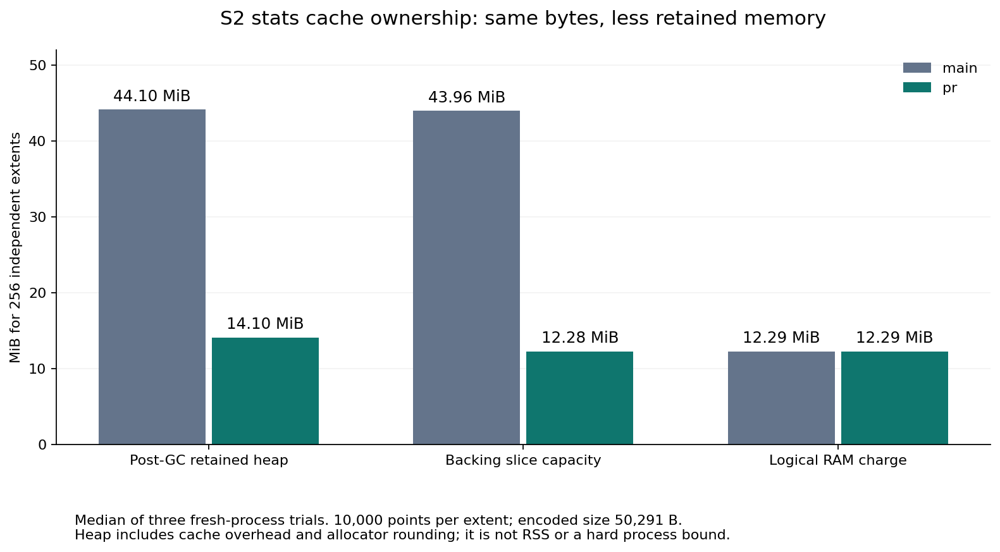
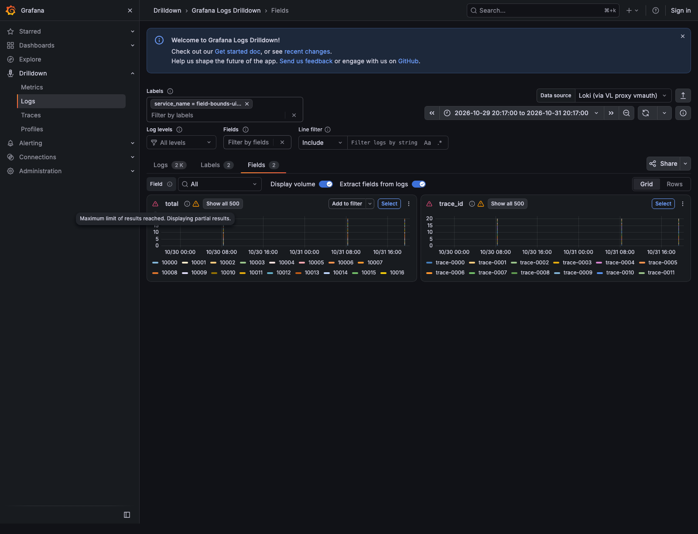

# Owned S2 stats cache buffers: main versus PR

S2 allocates output for the worst case. A 50,291-byte compressed extent retained
180,070 backing bytes in cache, whose payload charge uses length. The encoder
now copies output with excess capacity into a new exact-length owner buffer.
A capacity-only reslice would keep the allocation alive and would not fix this.

## Sources and measurement scope

- Main: `fe43377f2ac78bdd4069d5ad5220f1a6ceeb6007`.
- Production implementation: `74900fedce7ee537900895979096adbdbd3a77fc`.
- Measured candidate fleet binary: `8e848caf743b6c96c0b9561b7c1d24c07a0fc05e`;
  intervening commits only add conformance wiring and a decoder benchmark.
  Both fleet binaries report clean source trees. Full identities and SHA256s
  are retained in codec/provenance.json and fleet/*-index.json.
- Subsequent main release metadata `28a5a2f` is integrated; it does not change
  the measured production Go/module sources. Measurements keep their original
  identities rather than being relabelled to the later metadata/evidence head.
- Go 1.27.3, Darwin/arm64, Apple M5 Pro, codec benchmarks GOMAXPROCS=4.
  Same test harness for both binaries; the baseline benchmark overlays only
  stats_extent_cache.go from main. No other production Go file changes.
- Same-source control precedes main/PR/PR/main blocks, six samples per source,
  300ms per benchmark. Other user services continue running; no quiet-host or
  production throughput claim. Allocation controls are stable. Timing controls
  still vary, notably the varied-value fixture; do not infer speedup.

## Retained memory

256 independently encoded extents, 10,000 points each; median of three fresh
processes. A fixture and cache exist before the baseline. Two GCs precede both
ReadMemStats samples; fixture and cache remain alive through the measurement.
The optional disk queue retains the same slices as RAM, not a second copy.

| Metric | Main | PR |
|---|---:|---:|
| Encoded bytes per extent | 50,291 B | 50,291 B, byte-identical |
| Backing capacity per extent | 180,070 B | 50,291 B (-72.1%) |
| RAM post-GC heap delta per entry | 180,638 B | 57,759 B (-68.0%) |
| RAM plus pending disk queue, heap delta per entry | 180,803 B | 57,902 B (-68.0%) |
| Logical RAM charge per entry, including key | 50,320 B | 50,320 B |
| RAM heap delta for 256 entries | 44.10 MiB | 14.10 MiB |



Heap deltas include allocator rounding and cache overhead. They are not process
RSS, total cache footprint, an RSS reduction for a production fleet, or a hard
memory limit. Temporary encoding still allocates the serialization and S2
worst-case buffers, plus the compact output. Pprof supports the allocation-site
finding; whole-profile totals include unrelated sampled package initialization
and must not be used as the cache-savings estimate. Raw trials are in
codec/*-retained-*.txt, with medians in heap-summary.json and representative
in-use profiles under profiles/.

## CPU and allocation trade-off

| Operation | Main | PR |
|---|---:|---:|
| Cold encode, 10-point fixture | 4 allocs, 704 B/op | 5 allocs, 832 B/op |
| Cold encode, 10,000 compressible points | 24 allocs, 1.039 MiB/op | 25 allocs, 1.093 MiB/op |
| Cold encode, 4,000 varied values | 23 allocs, 815.2 KiB/op | 24 allocs, 919.3 KiB/op |
| Empty encoding | 1 alloc, 32 B/op | Same; no extra copy |
| Warm decoder, 10,000 points | 24 allocs, 1.575 MiB/op | Same |
| Encoder time, compressible points | 174.7 us | 166.6 us; not statistically different |
| Decoder time | 188.0 us | 199.8 us; not statistically different |

Compaction adds one compressed-length copy and allocation whenever output has
excess capacity. The allocated bytes include allocator rounding: the extra
allocation for the 50,291-byte payload is 57,344 bytes. Measured time does not
establish that the copy is free. No new dependency, codec, format or budget.
All four encoded fixtures (empty, small, compressible, varied) are identical
between sources; see codec/wire-identity.json. Exact raw controls/comparisons
are in codec/control-benchstat.txt and codec/comparison-benchstat.txt.

An earlier whole-handler moving-window benchmark had varying allocations even
between identical-source controls. Its unprimed per-window state and short
iteration counts confound a steady-state comparison. The retained diagnostic
does not prove a warm-handler speedup or regression. The separate decoder
benchmark removes that changing handler state.

## Real Loki and three-proxy fleet proof

Isolated Loki 3.7.9 / VictoriaLogs 1.52.0; same immutable 192,000-line fixture,
320 setup shards. Each selected cell uses two shards. Both sources select the
same ten cell identities/queries and hash-ring addresses, with separate fresh
proxy processes, cache files and observation ledgers. Candidate copies only
setup metadata; it neither reseeds data nor reuses main's cache files. Backend
and reference-Loki caches are shared and may already be warm. Actual container
image identities are retained in fleet/backend-identities.json.

Three proxies, RF1/RF2, compatibility Tier0 off; primary RAM 64 MiB / 1,024
entries per node, disk logical 64 MiB, S2, 1s/1,000-entry flush, 16 MiB write queue.
The writer/index/codec scratch are additional memory. Every measured cell has
20 successful nonempty answers equal to Loki: 400/400 total, zero parity errors.
This is a small immutable native count workload, not the high-cardinality live
Fields dataset or a workload-pressure/scaling experiment.

| State | RF | Main p50 / p95 ms | PR p50 / p95 ms | VL calls main / PR | Peer calls main / PR |
|---|---:|---:|---:|---:|---:|
| exact | 1 | 0.179 / 0.240 | 0.160 / 0.205 | 0 / 0 | 0 / 0 |
| exact | 2 | 0.226 / 0.294 | 0.128 / 0.160 | 0 / 0 | 0 / 0 |
| shifted | 1 | 6.007 / 7.143 | 3.945 / 4.812 | 40 / 40 | 13 / 13 |
| shifted | 2 | 4.672 / 6.752 | 3.921 / 5.145 | 40 / 40 | 27 / 27 |
| refresh | 1 | 6.546 / 7.826 | 4.146 / 5.359 | 40 / 40 | 13 / 13 |
| refresh | 2 | 6.155 / 7.872 | 4.515 / 7.027 | 40 / 40 | 26 / 26 |
| restart | 1 | 1.330 / 2.073 | 1.277 / 1.575 | 0 / 0 | 13 / 13 |
| restart | 2 | 0.945 / 1.687 | 0.936 / 1.743 | 0 / 0 | 7 / 7 |
| node 0 down | 1 | 1.453 / 1.777 | 1.129 / 1.914 | 0 / 0 | 10 / 10 |
| node 0 down | 2 | 0.826 / 0.958 | 0.833 / 1.010 | 0 / 0 | 0 / 0 |

These sequential source blocks are descriptive, instrumented loopback timings,
not a causal speedup measurement. Fleet phase CPU counters sum to 360.712ms
on main and 329.561ms on PR across 200 measured requests each; they include
background process work and are not isolated handler CPU.

Measured backend work is unchanged: 160 VL requests / 42,586 response-body
bytes and 109 peer contacts per source. Priming and startup are separate in
raw cells. The first startup block has nine health/metrics reads on both
sources; its larger candidate body count is three /metrics replies growing
from 35,109 to 38,444 bytes as backend counters appear, not extra query data.
Raw request paths, ranges, response-body bytes and wire bytes are retained.
Wire bytes and encoded disk traffic are not physical SSD throughput or IOPS.

Cold priming, exact/shift/refresh history and restart snapshots are retained
per cell. The owner-loss mode stops node0 and starts surviving proxies with
fresh RAM. It does not force every queried key's owner to be node0; zero VL
reads in those cells do not prove that RF1 can lose its only copy without a
backend read. No owner-targeted loss or exhausted-budget pressure claim.

Semantic layers remain separate. Exact repeats have Loki primary L1 hits and
bypass VL lookups; compatibility Tier0 is disabled, not measured as missing.
Shifted/refresh cells each have VL primary L1 bucket hits. Each missing minute
is fetched with two VL calls: severity-source discovery and stats_query_range;
both calls are limited to that missing minute. Already held buckets are reused.
A bucket hit therefore does not mean the whole request avoids VL. The fleet harness does not capture the internal
stats-extent outcome counter; the separate real e2e below asserts hit/partial
outcomes. Layer/tier hits, lookups, evictions, encoded disk I/O, memory gauges,
sampled-alive-process file lengths, Loki cache statistics and backend ranges
are retained in raw cells and fleet-summary.csv/json. Background priming
flushes can increment disk-write counters during a measured cache hit.

VL-server CPU/RSS, fleet OS RSS and physical device I/O were not isolated.
Darwin's process-memory export is Go MemStats.Sys, not RSS; process-lifetime
kernel Maxrss in raw cells is a different scope. Disk byte quotas are logical,
not hard bbolt-file limits. No TTL/freshness, tenant/auth identity, invalidation,
replica placement, concurrency or overall memory-budget guarantee changes.

## Regressions and CI

- New ownership regression fails on main for small/large/varied values; disk
  queue regression fails for raw/S2/zstd. Candidate passes both and verifies
  decode/render identity, subsequent-encode isolation and restart deadlines.
- Existing real Loki/VL extent test passes on main (2.760s) and candidate
  (4.038s), covering six query shapes, exact repeats, shifts, refresh and
  widening. It requires actual extent hit/partial outcomes. Test durations
  are not query latency. It is already selected by CI's TestCompat_.* shard.
- Fresh root suite: 21,355 passing test/subtest events, 13 test-bearing packages,
  zero failures; focused stats extent race plus disk/peer restart-codec race
  pass. Fuzz campaign: 96,365 executions, no failure. The new ownership target
  runs in CI's explicit 12s fuzz-smoke step, not only as seed cases.
- Lint0, configured gosec0 without type errors, actionlint, 40 CI wiring tests,
  changelog and full-results conformance pass. Independent review covers source,
  memory measurement, format compatibility and proof limitations.
- No Grafana-visible result changes are intended: the same encoded bytes decode
  to the same answers. The exact API/parity and memory proof above cover this
  change; CI's nine general Visual smoke scenes still run for the product diff.

## Rebuilt playground browser proof

All twelve local proxy variants were rebuilt/recreated at source
`378a08ba1648fcdf8bb2501f77cbb00a7601807f` (production-identical to the measured
implementation). Readiness, image identity, the explicit patterns500-series
limit and fresh generated logs through proxy and Loki were verified; backend
volumes were retained. Image identity and versions are in playground/provenance.json.
Both24h/48h browser tests pass9.6s on Grafana13.2.1/Drilldown2.5.2 with Loki3.7.7
and VL1.52.0, requiring500 populated frames, rendered canvas, visible partial
notices and no API/page errors. This is candidate-only rendering evidence,
not a main/PR latency or three-way screenshot comparison. Test durations do
not measure page-load or query latency.




## Reproduction

From a checkout containing this change, retain main's one differing production
file and compile the identical benchmark harness twice with a Go overlay:

```sh
ROOT="$PWD"
OUT="$(mktemp -d /tmp/s2-retention.XXXXXX)"
git show fe43377f2ac78bdd4069d5ad5220f1a6ceeb6007:internal/proxy/stats_extent_cache.go > "$OUT/main.go"
python3 - "$ROOT" "$OUT" <<'PY'
import json, pathlib, sys
root, out = map(pathlib.Path, sys.argv[1:])
(out/'overlay.json').write_text(json.dumps({'Replace': {str(root/'internal/proxy/stats_extent_cache.go'): str(out/'main.go')}}))
PY
go test -overlay="$OUT/overlay.json" -c -o "$OUT/main.test" ./internal/proxy
go test -c -o "$OUT/pr.test" ./internal/proxy
GOMAXPROCS=4 "$OUT/main.test" -test.run='^$' -test.bench='^(BenchmarkStatsExtentEncodeOwned|BenchmarkStatsExtentDecodeOwned)$' -test.benchmem -test.benchtime=300ms -test.count=6 > "$OUT/main.txt"
GOMAXPROCS=4 "$OUT/pr.test" -test.run='^$' -test.bench='^(BenchmarkStatsExtentEncodeOwned|BenchmarkStatsExtentDecodeOwned)$' -test.benchmem -test.benchtime=300ms -test.count=6 > "$OUT/pr.txt"
benchstat "$OUT/main.txt" "$OUT/pr.txt"
```

Run identical-source controls first, then main/PR/PR/main blocks as retained in
codec/. For memory use a fresh process per trial with
`-test.bench='^BenchmarkStatsExtentRetainedCache$' -test.benchtime=1x`.
Set S2_HEAP_PROFILE_DIR to an existing directory to retain the in-use profiles;
S2_ENCODED_PROOF_DIR retains exact encoded fixture bytes from the encoder bench.
For fleet reproduction use the existing TestDLVCacheBaseline setup/measure
harness with two shards per cell, two setup namespace repetitions,20 samples,
native only,Tier0off,RF1/2,all five states. Use separate source output/cache
directories sharing only fixture/setup metadata and identical backend/ring
addresses; select repeat0 on both. Do not reseed the immutable fixture.
See the parent harness README for setup, binary provenance and cleanup flags.

`python3 summarize.py` verifies uncompressed hashes and all400 parity outcomes,
then regenerates the fleet CSV/JSON and matrix. `python3 plot.py` regenerates
the memory figure from heap-summary.json (optional matplotlib dependency).
