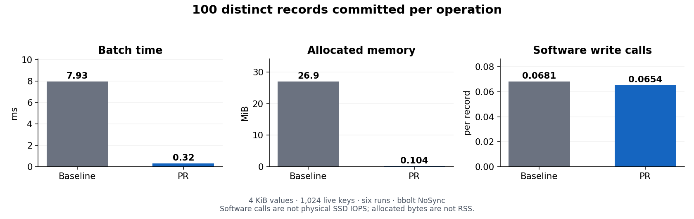

# Cache storage verification — 2026-10-30

The disk cache now batches writes asynchronously, evicts by LRU and stores
versioned S2/zstd/gzip/raw records. It retains legacy raw/gzip reads. No Go
dependencies were added or updated. [Operational limits and upgrades](../disk-cache.md)
describe the budgets, migration behavior and filesystem limitations.

## Constant work: 100 committed records

Both implementations commit exactly 100 distinct records per operation, using
4 KiB repeated-JSON values and 1,024 live keys. The explicit flush barrier
prevents the measurement from counting queued work as completed work. Six
samples used the same Apple M5 Pro, arm64, Go 1.27.3 and GOMAXPROCS=18. The base
is `7c59fafa50fcfbb5379871e77eb4fe14b154339e`.



| Per 100 committed records | Base | Updated |
|---|---:|---:|
| Median elapsed time | 7.933 ms | 0.320 ms |
| Allocated memory | 26.9 MiB | 106 KiB |
| Allocations | 6,855.5 | 999 |
| bbolt software write calls per record | 0.06811 | 0.06537 |
| Committed records | 100 | 100 |

The matched run reduces allocation volume by 99.62% and software write calls
by 4.02%. It does **not** establish physical SSD IOPS, bytes written, durability
latency or production end-to-end speedups. bbolt uses `NoSync`; cache data is
disposable. The measured improvement includes avoiding repeated expiry decoding
and bucket-stat scans, as well as changing the codec and batching implementation.
The host also ran other work; raw samples and repeat checks are retained.

The asynchronous admission benchmarks are listed separately in the raw results.
Only about 7–9% of their submitted same-key overwrites reach a committed record;
the others coalesce. Their admission time and logical payload rate are not
durable-write latency or device throughput.

## Reads, peers and profiles

The complete L2 fixtures use 256 B, 4 KiB and 64 KiB values with compressible and
deterministic random contents. Allocations fall from 11/19/26 to 10 per read,
respectively. Every read fixture asserts zero bbolt writes. A codec-only S2 or
zstd decode uses one allocation; that is not the allocation count of a complete
L2 lookup.

An initial, contended run suggested regressions on tiny random and large
compressible reads. A quieter matched repeat did not reproduce them: the 256 B
random median was 889.6 ns versus 827.7 ns (not statistically significant), and
the 64 KiB compressible median was 55.27 µs versus 41.47 µs. These fixtures are
warm in the OS page cache and do not measure a cold SSD.

Loopback peer fixtures avoid background disk work. Representative allocation
counts fell from 120 to 107 for a repetitive 4 KiB response and from 132 to 118
for random 4 KiB data. Timings were noisy, so no peer latency improvement is
claimed. Idle encoded-response scratch is bounded to 2 MiB per process; active
responses use additional memory.

The baseline batch allocation profile attributes 95.13% of sampled allocation
volume to expiry sweeping. The updated profile moves the principal costs to
queue admission and record encoding; idle, fresh-cache flushes do no database
writes. Profile totals describe allocation volume over the sampled run, not RSS.

Decoding remains outside the bbolt read transaction. Removing the encoded-input
copy saved an allocation in an isolated study but produced mixed latency and
did not prove writer/mmap contention safety.

## Correctness and security evidence

- The full Go suite passed. The final cache and proxy command packages also
  passed a fresh race/coverage run: 88.0% cache statement coverage and 89.3%
  proxy command coverage.
- A reference LRU model checks 10,000 deterministic randomized operations.
  Additional tests cover byte/entry/index limits, pending/flushing visibility,
  blocked writers, concurrent lifecycle calls, rollback, purge, restart and
  rejection of replacements that could otherwise expose older values.
- All four codecs survive a restart and codec-setting change through the real
  HTTP peer protocol. Tenant/auth-distinct keys remain distinct. Native
  corruption cannot fall back to an older legacy record.
- Malformed records are size-checked before copying or decompression. Tests
  cover a poisoned oversized key, an 8 MiB damaged record against a 1 KiB limit,
  checksums, truncated frames, unknown versions/codecs and malformed compressed
  payloads. Peer TTL conversion rejects overflow and endpoint text over 128 bytes.
  A fresh 15-second malformed-record fuzz run completed 949,996 executions.
- The three-proxy fleet proof passed against VictoriaLogs v1.52.0 and Loki
  v3.7.9, recording 668 requests. It covers disk restart, disk loss and peer
  refill, owner failure, full cache loss with Loki-equivalent rebuilt answers,
  full/unwritable disks, peer body bounds and restart under load. The near-now
  phase covers answer equality and the edge freshness contract; this build
  does not expose the optional label stream inventory path.
- Nine browser scenes captured main, PR and Loki. All 79 compared backend
  requests match between main and PR, with no new difference from Loki. One
  pre-existing error-rate series difference from Loki remains, alongside the
  documented metadata and history-dependent pattern differences. These scenes
  verify the general UI/API contract; the fleet proof exercises persisted L2.
- Lint and the Linux/amd64 dependency vulnerability scan passed. The separate
  code review found and rechecked fixes for key-size queue poisoning,
  allocation before validation and batch recency. These checks do not make
  local cache files authenticated; protect the cache directory.

## Reproduction and raw evidence

The [benchmark and fleet results](https://github.com/ReliablyObserve/loki-vl-proxy/tree/main/bench/cache-storage/results/2026-10-30)
include all samples, profiles and the fleet request/resource report. Use the
same [benchmark fixture](https://github.com/ReliablyObserve/loki-vl-proxy/blob/main/internal/cache/disk_policy_bench_test.go)
on the base and updated source trees.

```sh
go test ./internal/cache -run '^$' -bench '^BenchmarkDiskPolicyCommittedBatch$' -benchmem -benchtime=200ms -count=6
go test ./internal/cache -run '^$' -bench '^BenchmarkDiskPolicy' -benchmem -benchtime=300ms -count=5
go test ./internal/cache ./cmd/proxy -race -count=1 -coverprofile=coverage-cache.out
go test ./internal/cache -run '^$' -fuzz '^FuzzDiskRecordDecode$' -fuzztime=15s -parallel=4
go test ./internal/cache -run '^$' -bench '^BenchmarkDiskPolicyBatch/batch100$' -benchtime=2s -cpuprofile=cache-cpu.pprof -memprofile=cache-allocs.pprof
```

For the fleet proof, start a fresh `test/e2e-fleet/docker-compose.yml` stack with
the rebuilt image, then run `go test -tags=e2e -run '^TestFleetPeerCacheProof$'
./test/e2e-fleet -count=1 -timeout=15m -v`. Set the documented `FLEET_*` variables
when using alternative host ports; check IPv4 and IPv6 listeners for collisions.
