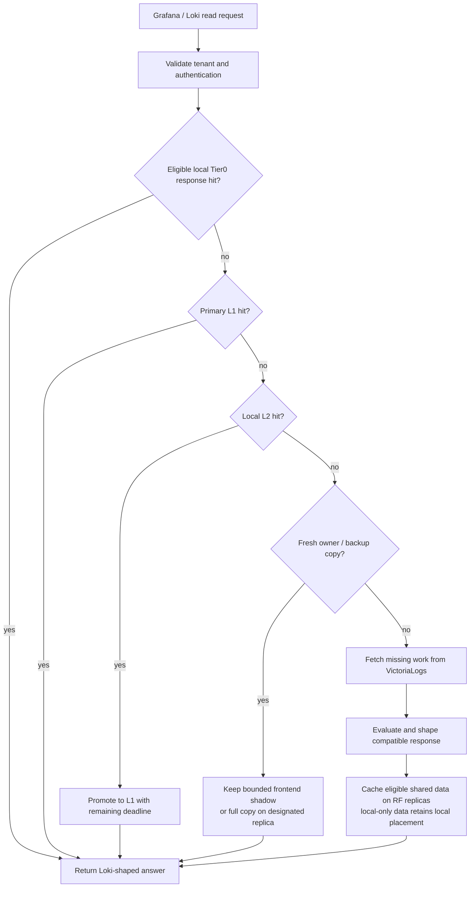

# Operating the fleet cache

This guide explains shared cache placement, capacity, backend load and verified operating limits. See [fleet architecture](fleet-cache.md) for discovery and the peer protocol, and [disk cache](disk-cache.md) for persisted records and upgrades.

## What improves

A load balancer can send repeated Grafana requests to different proxies. Eligible shared data is placed on the key's configured replicas, rather than keeping a persistent copy on every frontend that sees it. A frontend can reuse those replicas and retain a small, short-lived RAM shadow. This leaves more RAM and SSD capacity for distinct useful keys.

A replica's first disk read promotes the value into its RAM, so subsequent peer requests avoid another disk read. Restarting with retained disk can recover cached work without querying VictoriaLogs. RF=2 also provides a second cache copy when an owner is unavailable. These mechanisms reduce repeated backend scans and leave VictoriaLogs capacity for uncached queries.

For Grafana clients, less repeated scanning can reduce response latency and backend queue pressure, helping panels avoid load-related timeouts. Loki response labels, values, timestamps and error semantics remain the compatibility contract; cache placement improves delivery of those answers.

The cache reuses the proxy's existing Loki-compatible answers and safe intermediate results. It does not repair LogQL semantic differences, and a cache hit is not proof of compatibility by itself. The evidence below checks responses as well as cache activity.

A peer lookup is targeted, not broadcast: after local RAM/SSD misses, the proxy
calculates the key owner and backups from the membership ring, skips itself,
and tries those replicas in order. It stops at the first valid hit. RF=1 permits
one remote candidate; RF=2 permits owner then backup. Publication also targets
only the configured placements. This is cache-value transfer, not forwarding the
whole client query to another evaluator.

Remote hits add network bytes and owner work. Bounded frontend shadows absorb
repeats; keeping RF copies rather than a copy per frontend frees capacity for
more distinct shared keys. A large cached response, hot owner or slow network can
still cost more than another path. Compare peer bytes/latency and owner load with
VictoriaLogs calls, scanned ranges and response bytes before selecting capacity
or replication settings.

## Placement and failure choices

Pooled placement requires peer discovery, a consistent peer configuration and `-peer-write-through=true` (the default). RF includes the owner. Keys rejected by the peer publication filter, values above the peer body limit, and ordinary writes below `-peer-write-through-min-ttl` retain local fallback behavior. Forwarded-credential entries are not published.

| Behavior | RF=1 | RF=2, default |
|---|---|---|
| Full-TTL shared copies in a stable ring | Owner | Owner and one backup |
| Persistent shared copies per eligible key | 1 | 2 |
| Nonowner frontend copy | Bounded RAM shadow, no extra disk copy | Bounded RAM shadow, no extra disk copy |
| Restart with the owner's disk retained | First disk hit promotes to owner RAM | Same |
| Owner unavailable or its disk lost | Recompute if no other usable local copy exists | Try the fresh, reachable backup before recomputing |
| Capacity tradeoff | More distinct data per fleet | Less distinct capacity, with an extra recovery copy |

Nonowner shadows have at most 30 seconds of residency. They share the primary L1 ceiling and are additionally capped at 10% of its key/value bytes and entry slots. Their own LRU cannot evict owned or explicitly local entries. Source expiry is tracked separately: shortening residency does not make an old value fresh or make a fresh value appear artificially old.

Full frontend query-range responses and explicitly local caches remain separate from the pooled category. Memory-only data stays off disk when fetched from peers or by read-ahead. Disabling write-through retains local placement behavior; do not use the pooled-capacity estimate for that mode.

For equally sized nodes, a balanced, stable workload has a theoretical distinct full-copy capacity of approximately:

    total logical capacity / RF = N × per-node capacity / RF

Three nodes with a configured **32 GiB logical disk budget each** therefore offer about **96 GiB at RF=1**, or **48 GiB at RF=2**, before overheads, imbalance, local-only data and capacity reserved for other uses. This is arithmetic, not measured usable or physical storage. Entry/index limits can bind first; bbolt can retain freed pages in its physical file. Historical nonowner records are not migrated away by this change, and existing records are not automatically redistributed when ring membership changes.

## Scaling readers and owners

Adding frontend replicas increases capacity for concurrent requests. Query
evaluation remains in the receiving proxy; adding proxies does not automatically
split one query's computation across them. Per-query window and backend fetch
concurrency are separate mechanisms.

The default Helm DNS discovery selects all pods in the release, so scaling that
release also changes the ownership ring. To scale readers while keeping a warm
owner pool fixed, use a separate reader deployment with an owner-only HTTP or
static discovery list. List individual owner addresses matching their
`-peer-self` identities, rather than a load-balanced address hiding several
owners. Both deployments must share the peer token. Consistent backend endpoint
and authentication configuration is also needed to reuse the same cache keys.

With the default chart NetworkPolicy, enabling peer cache permits TCP 3100 to
same-release pods. Cross-release or external owners require explicit reader
egress and owner ingress rules; HTTP discovery also needs access to its registry.
Readiness does not prove owner discovery or cache warmth: check `/_cache/peers`
and actual backend reads before treating a new reader as warm.

Owner-pool growth changes placement without transferring existing records.
Measure cold-reader reuse and owner-ring expansion separately. The three-node
capacity proof below establishes its bounded workload; linear throughput on
larger deployments still requires measurement.

## Which requests reuse work

| Request pattern | Reuse available | Work that may still reach VictoriaLogs |
|---|---|---|
| Identical eligible repeat | Local final response, primary RAM/disk, or a peer copy | Expired, evicted, ineligible or missing entries |
| Shifted historical window | Eligible settled windows, metric extents and evaluation steps already read | Missing ranges, new steps and freshness-sensitive portions |
| Dashboard refresh | Reuse settled fragments across overlapping ranges | Recent data and newly exposed ranges |
| Process restart with retained disk | Persisted compatible records, then RAM promotion | Entries not persisted, expired or rejected |
| Owner loss | RF=2 backup when fresh and reachable | RF=1 misses, or no usable replica |

Reuse preserves the applicable tenant/authentication identity, query semantics, parser behavior, evaluation step/phase, time boundaries, error behavior and limits. A fragment fetched with insufficient limits is not a substitute for a complete answer. Changing an end time does not make arbitrary queries shareable.

Defaults keep near-now query-range result caching disabled (`-query-range-recent-cache-ttl=0`). `-query-range-freshness=10m` separates recent work; eligible historical windows use `-query-range-history-cache-ttl=24h`. Metric extents and settled steps use `-query-range-extent-cache=true` and `-query-range-extent-cache-ttl=1h`. These existing controls trade reuse against visibility of late-arriving data; finite TTLs remain necessary.

## Resource budgets and tuning

The executable currently creates a **256 MiB primary L1** (`-cache-max-bytes=268435456`, `-cache-max=10000`) and a **separate Tier0 compatibility cache** sized at 10% by default (`-compat-cache-max-percent=10`, 1000 entries). Tier0 adds about **25.6 MiB** of logical capacity; it is not subtracted from primary L1. Combined default logical capacity is therefore about **281.6 MiB**, before bookkeeping and other memory. The shadow allowance is **inside** primary L1, not another 25.6 MiB allocation.

Logical RAM accounting counts keys and values, not process RSS. Entry/list metadata, Go allocation overhead, compression state, active peer requests, disk queues and the disk index need additional memory.

| Setting | Default | Operational meaning |
|---|---:|---|
| `-cache-ttl` | `60s` | Generic metadata-cache TTL; endpoint-specific policies can differ |
| `-labels-cache-ttl` | `0`, selects `5m` | Label/label-value response TTL |
| `-disk-cache-path` | Empty | L2 is disabled until a path is supplied |
| `-disk-cache-max-bytes` | `0` | No logical byte cap; set an explicit budget when enabling L2 |
| `-disk-cache-max-entries` | `100000` | Persisted entry cap |
| `-disk-cache-max-index-bytes` | `16777216` | Estimated recency metadata, charged at 128 bytes plus key length |
| `-disk-cache-max-buffer-bytes` | `16777216` | Combined pending/flushing queue budget, including keys and overhead |
| `-disk-cache-flush-size` / `-disk-cache-flush-bytes` | `1000` / `4194304` | Background flush triggers |
| `-disk-cache-flush-interval` | `5s` | Time-based flush trigger |
| `-disk-cache-min-ttl` | `30s` | Ordinary disk-write eligibility threshold |
| `-disk-cache-codec` / `-disk-cache-compress` | `s2` / `true` | New records use S2 by default; compression false writes raw |
| `-peer-replication-factor` | `2` | Owner plus one backup |
| `-peer-write-through-min-ttl` | `30s` | Ordinary peer-push eligibility threshold |

The disk index and queue budgets are separate: their defaults permit about **32 MiB of accounted metadata/queued data combined**, in addition to L1 and other runtime memory. Larger caches may require raising the entry/index caps as well as the byte cap. LRU removes cold persisted records to admit new ones; reads update recency in RAM without a disk write. Batching limits transaction frequency, while the bounded queue can reject admission under slow storage.

Choose RF from the capacity/recovery tradeoff, set an explicit logical disk budget, and measure representative query ranges. Raising TTLs or all budgets together can hide pressure while increasing staleness and retained memory.

## Protecting VictoriaLogs and checking results

Existing local request coalescing lets concurrent identical work on one proxy share an in-flight computation. Shared cache hits reduce later requests across the fleet; eligible fragment reuse reduces the amount of backend data read. Bounded caches and write queues keep cache storage pressure finite.

This is not a fleet-wide miss lease or a hard backend rate limit. Several proxies can miss simultaneously before publication completes. A cold working set, eviction, expiry or an unhealthy peer can still create backend work. Measure actual backend requests and ranges, not just cache hit ratio.

For rollout and restart protection:

- Preserve per-node cache disks when practical, and keep the replica configuration consistent across peers.
- Use `-warmup-max-jitter` to spread startup work (default `0` adds no jitter). This staggers work; it does not coordinate a single fleet-wide fill.
- Account for `-labels-cache-warm=true`: startup and periodic warming cover the 1h/6h/24h/7d label-picker presets, including scans up to seven days. Replicas that serve no interactive label pickers can use `-labels-cache-warm=false` and fill on demand.
- Keep freshness settings aligned with acceptable late-data visibility. The default near-now bypass still reads VictoriaLogs for current data.

A failed owner may cost up to `-peer-timeout` (default `2s`) before backup/fallback work. RF=2 reduces recomputation when a backup is usable; it does not eliminate failure-detection latency.

Useful existing metrics include:

- `loki_vl_proxy_cache_tier_hits_total`, `loki_vl_proxy_cache_tier_misses_total` and `loki_vl_proxy_cache_tier_evictions_total`, with `tier="l1_memory"`, `"l2_disk"` or `"l3_peer"` as applicable.
- `loki_vl_proxy_cache_bytes`: L1 accounts stored key/value bytes; L2 reports the physical bbolt file size, including retained free pages. It does not report logical admission bytes or remaining capacity under `-disk-cache-max-bytes`. `loki_vl_proxy_cache_objects` reports local object counts.
- `loki_vl_proxy_cache_backend_fallthrough_total` for misses through all cache tiers.
- `loki_vl_proxy_peer_cache_fetch_duration_seconds`, with owner/backup and hit/miss/error labels.
- `loki_vl_proxy_coalesced_saved_total`, `loki_vl_proxy_coalesced_wait_nanoseconds_total` and `loki_vl_proxy_coalesced_wait_count_total` for local duplicate suppression and waiting.

The metric tier `l0` is the hot-key index sidecar, not the separate Tier0 final-response cache. Pair these counters with response comparisons and p50/p95 timings for exact repeats, shifted windows, refreshes, disk restarts and owner loss. No result here establishes that every warm query is faster than Loki.

## Deletion, expiry and purge

LRU is a capacity policy, not data invalidation. Deleting or expiring data directly in VictoriaLogs does not automatically invalidate cached answers. Finite cache TTLs or explicit operational cache flushes are still required.

Local `PurgeAll` clears memory and disk and fences disk reads that began before the purge from promoting their old snapshots afterward. Promotion is also disabled while a local disk purge is in progress, including overlapping purges. Waiting for the L1 mutex does not renew the source deadline.

The [admin flush and peer fanout](fleet-cache.md#ring-wide-cache-flush) can purge known peers; inspect every result and retry failures. This is not an atomic distributed deletion barrier: in-flight remote work, unreachable peers and ring changes still require coordination. Do not treat it as a security purge guarantee or a distributed invalidation epoch.

## Verified behavior, 2026-10-30

The [bounded three-node HTTP capacity test](../internal/cache/peer_capacity_e2e_test.go) uses production caches and peer handlers with a deterministic, counted backend. Each node has 64 entries and 16 KiB per tier:

| Configuration | Distinct keys | Persistent copies | Warm reads | Additional backend computations |
|---|---:|---:|---:|---:|
| RF=1 | 150 | 150 | 450 | 0 |
| RF=2 | 90 | 180 | 270 | 0 |

Both datasets exceed one node's capacity. Tests also cover shadow churn, owner disk promotion, RF-specific recovery and safe misses after loss.

The [real three-proxy/Loki/VictoriaLogs reports](https://github.com/ReliablyObserve/loki-vl-proxy/blob/main/bench/cache-placement/results/2026-10-30/README.md) record RF=1 with **664 requests / 35 passing case events / 264.566 s**, and RF=2 with **666 requests / 35 passing case events / 239.620 s**. Those totals describe the integration runs, not a controlled RF performance comparison.

Visual evidence covers **nine scenes and 27 screenshots**: **79/79 main-versus-change answers identical**, with **zero new Loki differences**. Seven shared existing Loki discrepancies remain. The evidence establishes placement and checked response preservation; it does not claim zero semantic gaps, automatic rebalancing, or universal warm-latency wins.
