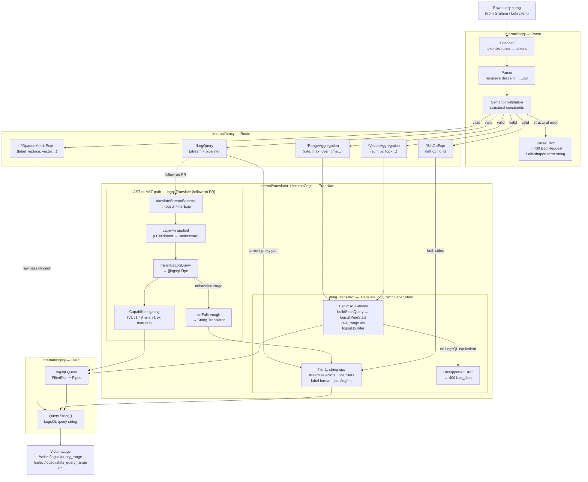
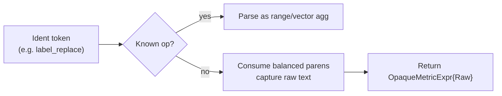
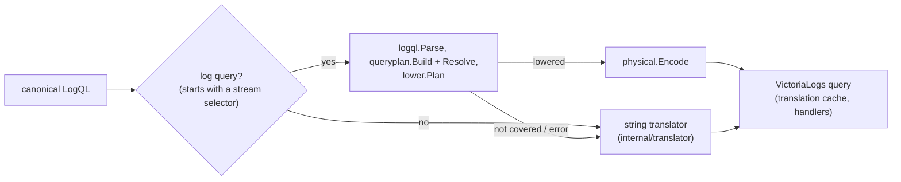
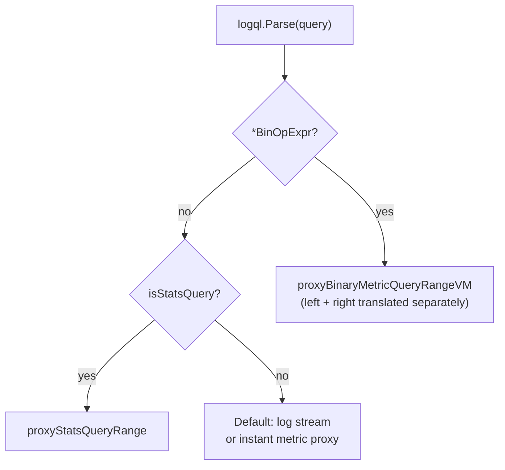

# LogQL Parser — Internal Design

The `internal/logql` package provides a typed LogQL parser that powers query validation, structural routing, and drop/keep extraction throughout the proxy. It replaced the previous regex-based approach with a proper recursive-descent parser that builds a typed AST, enabling accurate semantic validation and reliable query decomposition without false positives.

## Why a Typed AST?

The old approach used regular expressions layered on top of the raw query string. This worked for simple cases but broke on:

- Nested expressions (vector matching with `on()`/`group_left()`)
- Embedded regex inside label matchers (e.g. `{app=~"api|web"}`)
- Ambiguous operator sequences (`!=` inside a string vs. between labels)
- `rate_counter` requiring `| unwrap` — impossible to validate structurally without an AST

The typed AST makes these cases explicit. Each node type is a Go struct with typed fields, so routing logic (is this a range aggregation? a binary expression?) becomes a type switch rather than a regex match.

## Package Structure

| File | Purpose |
|---|---|
| `scanner.go` | Lexer: converts raw query string to a token stream |
| `parser.go` | Recursive-descent parser: builds typed AST from tokens |
| `ast.go` | AST node types (`LogQuery`, `RangeAggregation`, `VectorAggregation`, `BinOpExpr`, …) |
| `semantic.go` | Semantic validation pass: checks constraints that require AST understanding |
| `validate.go` | Public API: `ValidateLogQL(query) string` — Loki-compatible error messages |
| `translate.go` | Bridges AST to the translator package: normalises to canonical LogQL, then delegates |

## Data Flow



**Four consumers of the LogQL AST:**

1. **Validation** (`ValidateLogQL`) — called on every inbound query before any work is done. Returns a Loki-shaped error string (`"parse error at line 1, col 1: ..."`) or `""` if valid.

2. **Routing** (`proxy.go`) — calls `logql.Parse()` on the validated query and type-switches to dispatch binary expressions and range aggregations to separate execution paths.

3. **Translation** (`TranslateLogQLWithCapabilities` and `logql.Translate`) — two paths described in detail below.

4. **Drop/Keep extraction** (`stream_processing.go`) — calls `logql.ParseAndValidate()` to extract `| drop` / `| keep` matchers for post-processing VL response streams.

## AST Node Hierarchy

```
Expr (interface)
├── *StreamSelector          {app="api", env=~"prod.*"}
├── *LogQuery                StreamSelector + []Stage pipeline
│   └── Stage (interface)
│       ├── *LineFilterStage         |= "text" / |~ "re" / |> "pattern"
│       ├── *ParserStage             | json / | logfmt / | regexp / | pattern / | unpack
│       ├── *LabelFilterStage        | level="error" (raw, opaque)
│       ├── *LineFormatStage         | line_format "{{.msg}}"
│       ├── *LabelFormatStage        | label_format dst=src, tmpl="{{.x}}" (parsed entries + raw)
│       ├── *UnwrapStage             | unwrap bytes(label)
│       ├── *DropStage               | drop a, b, c=~"re"
│       ├── *KeepStage               | keep a, b
│       └── *DecolorizeStage         | decolorize
├── *RangeAggregation        rate({...}[5m]) — argument is always a log query (no subqueries)
├── *VectorAggregation       sum by (label) (rate(...)) / topk(5, ...)
├── *BinOpExpr               left op right, optional VectorMatching
├── *LiteralExpr             scalar 3.14
└── *OpaqueMetricExpr        label_replace(...), vector(...) — raw pass-through
```

### Opaque pass-through nodes

Two node types capture content without parsing it:

- **`LabelFilterStage`** / **`LabelFormatStage`** — the inner expression grammar for `| level > 1` or `| label_format dst=src` is complex and context-dependent. These stages capture the raw text after the keyword so the translator sees exactly what Loki would see.

- **`OpaqueMetricExpr`** — metric-level functions that aren't yet expressible in the AST (`label_replace`, `vector`, `approx_topk`; any other name is a Loki parse error). The parser captures the full raw text including balanced parentheses and returns it verbatim so VictoriaLogs receives the original expression unchanged.

## Scanner

The scanner (`scanner.go`) is a hand-written lexer with no external dependencies. Key design choices:

- **Single-pass, no backtracking.** Each call to `scan()` advances exactly one token.
- **Disambiguates `!=` vs `!~` vs `!>` vs `!=` (label vs line filter).** Context is resolved by the parser, not the scanner — the scanner emits separate `TokBangEq`, `TokBangTilde`, `TokBangGt` tokens.
- **Range durations** (`5m`, `1h`, `$__auto`) are emitted as `TokDuration` inside a `[range]`, with the unit string preserved.
- **Number, duration and bytes literals** outside a range are read as Loki's lexer reads them (see [Lexical rules](#lexical-rules-of-lokis-lexer)): `TokNumber`, `TokDurationLit` (`offset 5m`, `-5m`) and `TokBytes` (`5KB`).
- **Quoted strings** are unescaped; raw backtick strings are returned verbatim.
- **Lexer errors** (a malformed number, NUL, an unclosed `[`) are noted by the scanner as it reads the token, and `Parse` reports the first one ahead of any parse error, as Loki does.

## Parser

The parser (`parser.go`) is a recursive-descent parser with one-token lookahead. The top-level entry points are:

```go
// Parse returns the typed AST or an error.
func Parse(input string) (Expr, error)

// ParseAndValidate parses and runs the semantic pass; returns the first error.
func ParseAndValidate(input string) error
```

### Grammar summary (simplified)

```
Expr           := Primary (BinOp Primary)*
Primary        := VectorAgg | RangeAgg | UnknownMetricFn | LogQuery | '(' Expr ')' | Literal
VectorAgg      := VecOp [Grouping] '(' [Param ','] Expr ')'
RangeAgg       := RangeOp '(' LogQuery '[' Range [':' Step] ']' [Offset] ')' [Grouping]
UnknownMetricFn:= Ident '(' ... ')' → OpaqueMetricExpr (raw text)
LogQuery       := StreamSelector Pipeline*
Pipeline       := '|=' | '!=' | '|~' | '!~' | '|>' | '!>'   LineFilter
               |  '|' json | logfmt | regexp | pattern | unpack
               |  '|' LabelFilter (raw)
               |  '|' line_format | label_format (raw)
               |  '|' unwrap [Converter] Label
               |  '|' drop DropList
               |  '|' keep DropList
               |  '|' decolorize
```

### Unknown function handling

When the parser encounters an identifier followed by `(` that isn't a known range op or vector op, it captures the **raw input text** from the start of the identifier to the matching close paren (tracking nesting depth) and returns an `OpaqueMetricExpr`. This ensures `label_replace(sum by (level)(rate(...)), ...)` passes through to VictoriaLogs unchanged instead of causing a 503.



## Lexical rules of Loki's lexer

Loki lexes a query with Go's `text/scanner`, a duration and bytes attempt after every number, and a few lexer rules of its own. The proxy follows them, with Loki's error text and column, and every rule is held to the Loki parser by recorded answers (`internal/logql` `TestLabelFilterNumberLiteralsMatchLoki`, 53,000 queries; conformance case `semantics/label-filter-number-literal-scan`). The scan lives in `internal/logql/label_filter_literal.go`; the label filter lexer is `lfParser` in `label_filter_expr.go`, the query lexer is `scanner.go`.

| Rule | Behaviour |
|---|---|
| Number | Go's scanner: prefixes `0x` `0o` `0b` and a leading `0` (octal), `_` only between digits, decimal floats, hexadecimal floats that need a `p` exponent. Errors keep the scanner's text: `hexadecimal literal has no digits`, `exponent has no digits`, `invalid digit '8' in octal literal`, `'_' must separate successive digits`, `'p' exponent requires hexadecimal mantissa`, and so on, at the start of the literal. |
| Duration | After a number, the run of digits, `.` and `n u µ s m h d w y` is a DURATION when the whole text is Go's duration syntax or whole `y w d h m s ms` units, each once, largest first (`1d12h`; not `1h1d`, `1.5d`). Otherwise the number stands alone and the rest is the next token (`1h30` is `1` then the name `h30`). |
| Bytes | After a number, the run of digits, `.` and `B i k K M G T P` is a BYTES size when Humanize's size parser reads it in any case (`5kB`, `5Ki`, `5k`; `5kb` is `5k` then the name `b`; `5gb` is a number then a name), and the size fits 64 bits. |
| Sign | `-5m` (a minus right before a duration Go reads) is one DURATION token. A sign otherwise belongs to a NUMBER: `+5m` and `-5B` are `unexpected DURATION/BYTES, expecting NUMBER`. |
| `0b` after white space | A `0b` or `0B` literal that follows white space is `decimal literal has no digits`, whatever follows the prefix. Right after an operator (`a<0b1`) it is scanned normally. A comment takes the line break that ends it, so what follows is not after white space. |
| White space | Only space, tab, CR and LF. `\v`, `\f`, a non-breaking space and the like are tokens of their own (names). The query is parsed with the white space around it: a trailing control character is a token and the end-of-input column counts the trailing white space. |
| Names and other characters | A name is letters, digits and `_` (dots stay inside a name: the proxy's dotted names, `DottedNameError` for the Loki profile). Any other character is a token of its own: `+ - * / % ^ . { } ]` are named by themselves in errors, the rest are identifiers, `'x'` is a one-character literal (`invalid char literal`, `literal not terminated`), and `[` starts a range that needs its `]` (`missing closing ']' in duration`, line 0). Only an ASCII digit starts a number: another decimal digit (U+0663, U+0966, U+FF13), a superscript, a fraction and a Roman numeral start no token and are identifiers of their own, so `{app="a"} \| x ٣` and `\| x ²` are `unexpected IDENTIFIER`. The scanner must move on every character: a scan that reads nothing once made the parser loop without end (`FuzzParseTerminates` holds every entry point to 200 ms and a mebibyte per input byte). |
| Keywords | `by without bool offset on ignoring group_left group_right unless unwrap json regexp logfmt unpack pattern label_format line_format decolorize drop keep variants of` (any case) are keyword tokens wherever they stand, so a label filter cannot name a label `by`. `ip`, `label_replace`, `vector`, the range and vector aggregation names and the unwrap conversions (`bytes`, `duration`, `duration_seconds`) are keywords only before a `(` or a `by (`/`without (`, and print in upper case in errors (`unexpected RATE`, `BYTES_CONV`). |
| NUL | `invalid character NUL`, at the start of the token before it: its line when the NUL follows the token, line 0 when white space or a comment lies between. |
| Order of errors | A lexer error is reported ahead of the parse error it may cause, and for a query that parses, but only for tokens Loki has read when it stops: a parse error at a token hides the lexer error of a later one. |
| Binary operator after a label filter | `+ - * / % ^ == > >= < <= unless` after a complete filter belong to the query, whose left operand is the pipeline: the query goes on from there and a log query operand is `unexpected type for left leg of binary operation (+): *syntax.PipelineExpr` (`MatchersExpr` for a bare selector, `right leg` for the right operand; the left operand first). Inside parentheses the operator is a syntax error. |
| Float conversions | A number Go's `ParseFloat` cannot read (`0x1`, `0b1`, `1e999`) is `unable to parse literal as a float: strconv.ParseFloat: parsing ...` for an operand, `unable to parse vectorExpr as a float` in `vector()`, `invalid parameter for operation quantile_over_time: ...` and `invalid parameter topk(0x1,` for a parameter; Loki raises it after the left leg type check. |

Not covered: the content of a `[range]` keeps the scanner's older reading (`[0x1]` names the unit `x` of `0x`), a stage that starts with a bare name (`| x+y=1`) passes through to the backend as an unknown stage, and the content of a stream selector that is not closed (`{app="a"} + {`) keeps the generic error.

## Semantic Validation

After parsing, `validateSemantics` walks the AST and enforces constraints:

| Check | Error message |
|---|---|
| Empty stream selector `{}` | `parse error at line 1, col 2: queries require at least one matcher that is not a wildcard` |
| `rate_counter` without `\| unwrap` | `parse error : rate_counter requires \| unwrap expression` |
| Multiple `\| unwrap` stages | `parse error : syntax error: unexpected unwrap` |
| `rate()` / `bytes_rate()` referencing `__error__` | `parse error : __error__ and __error_details__ are not allowed inside rate() range vectors` |
| `quantile_over_time` phi < 0 | `parse error at line 1, col 1: invalid parameter for quantile_over_time: …` |
| `\| line_format` with unclosed `{{ }}` | `parse error : stage '…' : invalid line template: …` |
| Binary op with log stream on either side | `parse error at line 1, col 1: unexpected expression for binary operation` |

All error strings are formatted to match Loki 3.x responses so Grafana datasource clients receive the error shape they expect.

### ip() filter validation

The `ip("value")` line filter extension (parsed in `internal/logql/parser.go`, matched in `internal/logql/ip_filter.go`) validates the inner value at parse time with `net/netip`, following Loki's matcher rules: a single address (`netip.ParseAddr`), a prefix (`netip.ParsePrefix`), or an ordered same-family range (`a.b.c.d-e.f.g.h`, zones stripped). Validation is eager: the query is rejected with HTTP 400 even when the time range contains no data.

| Input | Parse error contains |
|---|---|
| Invalid address, prefix or range, e.g. `\|= ip("999.999.999.999")` | `ip: invalid pattern: "999.999.999.999"` |
| `ip()` with a line filter operator other than `\|=` or `!=`, e.g. `\|~ ip("10.0.0.1")` | `ip: invalid operation` |

A label filter stage that is one `ip()` comparison (`| addr=ip("zzz")`) is validated the same way and answers Loki's `parse error : stage '| addr=ip("zzz")' : ip: invalid pattern: "zzz"`; a stage that joins several filters is not, as in Loki. Matching is exact for IPv4 line filters and approximate for IPv6 (see [translation reference](translation-reference.md#proxy-side-stages)).

### Line filter runs

Loki builds the line filters of a pipeline as runs: a label filter, `line_format`, `unpack` and `unwrap` end a run, while `json`, `logfmt`, `regexp`, `pattern`, `label_format`, `drop`, `keep` and `decolorize` do not, so `|~ "(" | json |~ "["` is one run. An invalid line filter's error quotes the whole run (`stage '|= "x" |~ "("'`), names the run's last invalid filter, and comes in Loki's order next to the errors of other stages, as recorded with the Loki oracle.

### Pattern line filter validation

The pattern of a `|>` or `!>` filter may not hold two captures in a row (`found consecutive capture '<_><_>': invalid expression`) and its only capture is `<_>` (`named captures are not allowed: found '<foo>'`), as Loki builds it. Within one pattern, captures in a row are reported first; a `|>` chain is read in order and a `!>` chain, which Loki builds as one `!>` per alternative, from its last alternative. The `| pattern` parser keeps its named captures.

## ValidateLogQL API

```go
// ValidateLogQL returns a Loki-compatible error string, or "" if valid.
func ValidateLogQL(query string) string
```

Fast-path cases handled before parsing:
- Empty string → `parse error : syntax error: unexpected $end`
- Bare `*` → valid (Grafana sends this as a wildcard)
- Starts with `|` → `parse error at line 1, col 1: syntax error: unexpected |`
- Contains `<>` → parse error at the `>` position

Everything else goes through the full parse + semantic pass.

## Translation

### Query plan lowering (which translator answers)

A query is translated by one of two paths, and the client cannot tell which: the same VictoriaLogs query comes out of both, byte for byte, but for a label that LogsQL reads as a keyword (`not`, `in`, `options`, `and`, `or`, `contains_all`, `contains_any`, `contains_common_case`, `equals_common_case`, in any case): Loki accepts such a label, VictoriaLogs rejects it written bare, and the plan quotes it (`"not":="a"`) where the string translator does not.



- **Served from the plan:** log queries made of a stream selector, line filters (`|=`, `!=`, `|~`, `!~`), pattern filters (`|>`, `!>`) and label filters (including `ip()` and repeated filters), with no parser stage. `lower.Plan` builds the filters with the shared builders in `internal/translate` and `physical.Encode` writes the text. `-query-plan-lowering=false` returns every query to the string translator.
- **Still on the string translator:** every query with a parser or formatting stage (`| json`, `| logfmt`, `| line_format`, `| drop`, …), every metric query (range and vector aggregations, `unwrap`, binary operations, `label_replace`), and any log query the lowering answers with an error. That includes a regexp line filter (`|~`, `!~`) or an exact matcher on a stream field whose value is written with an escape (`\x41`, an octal escape), a raw control character or backquotes: the string translator sends the client's spelling of those two, and the lowering holds only the value, so it leaves them (`LogSelect escaped spelling`, counted as not lowered). Every other position, and a plain spelling of the same value, is still served from the plan.
- **Labels named after VictoriaLogs' own fields:** a label called `_time`, `_stream`, `_stream_id` or `_msg` reaches VictoriaLogs only as a tag of the stream, and a filter naming the field is VictoriaLogs' time, stream, stream id or line filter; the plan filters the tag (`{app="a"} | _time="x"` is `app:="a" {_time="x"}`, a comparison reads the tag's value out of `_stream`), and writes `_TIME`, `_Stream` or `_STREAM_ID` as the stream filter in a selector and, in a label filter, copies the field into a scratch field the filter reads (`| copy _TIME as __lxrf_TIME | filter __lxrf_TIME:="x"`): VictoriaLogs reads such a name bare as its own filter, and prints a quoted one bare when it clones the query, so only these forms read back as written. The string translator writes the field filter, which VictoriaLogs rejects or reads as its own filter (`_time:>=5s` is a time range).
- **Labels that are keywords:** a label Loki's lexer reads as a keyword token (`of`, `bool`, `offset`, `unwrap`, `json`, `regexp`, `logfmt`, `unpack`, `pattern`, `label_format`, `line_format`, `decolorize`, `drop`, `keep`, `variants`, in any case) is no label name: a stream selector, grouping list, drop or keep list, json or logfmt extraction, `label_format` or `unwrap` that names one is Loki's 400 with Loki's text. `Ip`, `IP` and `Label_replace` are labels (`ip` and `label_replace` are keywords only before a parenthesis) and keep their case.
- **Why it is safe to switch:** the corpus shadow (`TestPlanShadow`, see [testing](testing.md#query-plan-shadow)) asserts, for every native corpus row under each of the 12 translator profiles, that `physical.Encode(lower.Plan(...))` equals the translator's text byte for byte (with the keyword label names above quoted: `lower.QuoteKeywordFieldText`); the route-parity test sends the same queries through a fake VictoriaLogs with the flag on and off and compares the answers and every upstream request.

### LogQL stage → LogsQL pipe mapping

The AST-to-AST translator (`logql.Translate`) maps LogQL pipeline stages to `logsql` typed pipe nodes:

| LogQL stage | Condition | LogsQL output | Notes |
|---|---|---|---|
| `*StreamSelectorExpr` | always | `logsql.FilterExpr` | Label matchers `=`, `!=`, `=~`, `!~` |
| `*LineFilterStage` | `\|=` / `!=` / `\|~` / `!~` / `\|>` / `!>` | `logsql.PipeFilter` | Pattern filter `\|>` mapped to VL `seq()` or regexp |
| `*LabelFilterStage` | bare label condition | `logsql.PipeFilter` | Raw expression preserved; complex filters fall through |
| `*ParserStage` — json | always | `logsql.PipeUnpackJSON` | |
| `*ParserStage` — logfmt | always | `logsql.PipeUnpackLogfmt` | |
| `*ParserStage` — regexp | always | `logsql.PipeExtractRegexp` | |
| `*ParserStage` — unpack | always | `logsql.PipeUnpackJSON` | |
| `*DropStage` | bare labels only | `logsql.PipeDelete` | Matcher-based drop → `errFallthrough` |
| `*KeepStage` | bare labels only | `logsql.PipeKeep` | Matcher-based keep → `errFallthrough` |
| `*LineFormatStage` | simple templates | `logsql.PipeFormat` | Complex `{{` templates → `errFallthrough` |
| `*LabelFormatStage` | any | `errFallthrough` | No LogsQL equivalent yet |
| `*UnwrapStage` | any | `errFallthrough` | Handled by metric translator |
| `*DecolorizeStage` | any | `errFallthrough` | No LogsQL equivalent |
| `*RangeAggregation` | any | `errFallthrough` | Metric path via string translator |
| `*VectorAggregation` | any | `errFallthrough` | Metric path via string translator |
| `*BinOpExpr` | any | `errFallthrough` | Binary metric path |
| `*OpaqueMetricExpr` | any | raw pass-through | `label_replace`, `vector`, `approx_topk` |

`errFallthrough` is a package-private sentinel — callers route to `TranslateLogQLWithCapabilities` unchanged.

### Edge cases

| Situation | Behaviour |
|---|---|
| Empty stream selector `{}` | Semantic validation rejects before translation: `"queries require at least one matcher that is not a wildcard"` |
| `*=` / `!*=` matchers | Converted to `=~.*` / `!=.*` (LogsQL has no native glob) |
| Label names with dots (`service.name`) | `LabelFn` rewrites to underscores if OTel mode enabled; otherwise passed through |
| `\|~ ".+"` — always-true regex | Optimised away (no LogsQL equivalent needed) |
| `rate()` / `bytes_rate()` over `__error__` | Rejected at semantic pass: 400 |
| `quantile_over_time` φ < 0 | Rejected at semantic pass: 400 |
| Unknown function (`label_replace`, custom) | `OpaqueMetricExpr`: raw text forwarded to VL unchanged |
| VL version < required capability | `Capabilities` gating downgrades construct (e.g. `BestIPv4Range` → regexp fallback) |
| No LogsQL equivalent for valid LogQL | `UnsupportedError` — the query handler returns HTTP 400 with the translator message as the `text/plain` body (for example the message for a range aggregation such as `avg_over_time` written without an unwrap stage) |
| `| line_format` unclosed template | Rejected at semantic pass: 400 with template parse error |
| `| pattern` parser stage | Mapped to VL `seq()` word-match filter if caps allow, else regexp |

## Parser Stages and Series Identity

`ParserCaptureLabels` (`internal/logql/parser_captures.go`) reads the capture names of `| regexp` and `| pattern` stages from the parsed pipeline: the named groups of the Go regexp, and the `<name>` placeholders of a pattern (`<_>` skips). Metric routing adds them to the series identity, because Loki names a metric series with the stream labels plus every label the pipeline extracted.

The key set of `| json` and `| logfmt` is known only once a line is read, so it cannot come from the AST and the proxy keeps the stream identity unless `-exact-parser-series-identity` is set. [KNOWN_ISSUES.md](KNOWN_ISSUES.md) records the measured difference.

## How Routing Uses the AST

`proxy.go` calls `logql.Parse()` on the already-validated query (error cannot occur at this point) and type-switches to dispatch:



This is more reliable than the previous approach of injecting routing markers into the translated LogsQL string and re-detecting them downstream.

## Testing

The package has five test files:

| File | What it covers |
|---|---|
| `scanner_test.go` | Token-level scanning: identifiers, strings, operators, ranges |
| `parser_test.go` | Round-trip parse → String() for representative expressions |
| `ast_test.go` | AST node String() methods and edge cases |
| `semantic.go` tests (in `edge_cases_test.go`) | All semantic validation constraints |
| `edge_cases_test.go` | 116 exhaustive parity cases against Loki's behaviour |
| `bench_test.go` | Allocation and throughput benchmarks |
| `fuzz_test.go` | Corpus-based fuzzing: `go test -fuzz=FuzzParse` |

The 116 edge-case parity tests are driven by `query-semantics-matrix.json` and cover: invalid selectors, missing unwrap, quantile bounds, rate/bytes_rate with `__error__`, line format template validation, binary op constraints, and exhaustive LogQL syntax acceptance/rejection matching Loki's exact error strings.
